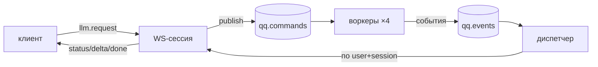

# cloud

Тонкий бэкенд QuipQuill: авторизация, шлюз к LLM и эмбеддингам (OpenRouter), очередь RabbitMQ + WebSocket. Игровой логики здесь нет. Протокол: [docs/architecture/protocol.md](../docs/architecture/protocol.md).

Стек: Python 3.13, uv, FastAPI, pydantic-settings, SQLAlchemy 2 + asyncpg + Alembic, PyJWT, pwdlib (argon2), aio-pika, openai SDK (OpenRouter), PostgreSQL 17, RabbitMQ 4.

## Запуск (из корня репозитория)

```bash
make infra-up       # Postgres :5432 + RabbitMQ :5672 (UI http://localhost:15672, quipquill/quipquill)
make cloud-migrate  # применить миграции Alembic к базе из DATABASE_URL
make cloud-dev      # API с автоперезагрузкой: http://127.0.0.1:8000/health, документация /docs
make cloud-test     # тесты; БД-тесты используют базу quipquill_test (создаётся автоматически)
make cloud-lint
```

Весь бэкенд в контейнерах (образ `cloud/Dockerfile`, ~430 МБ): `make app-up` — Postgres, RabbitMQ, одноразовый `migrate` (`alembic upgrade head`) и `cloud` на **http://localhost:8080** (`ENV=prod`, JSON-логи; секреты из `cloud/.env`). `make app-logs`, `make app-down`.

Новая миграция после изменения моделей: `cd cloud && uv run alembic revision --autogenerate -m "<что>"`, затем проверить файл в `migrations/versions/`.

## Авторизация

Гость устройства без email и пароля (ADR 60, включается `GUEST_SIGNUP`) или email + пароль, регистрация только по инвайт-коду (`INVITE_CODES`).

Дневной лимит трат — по тарифу (`llm/policy.py`, free $0.05 в UTC-сутки); `DAILY_COST_LIMIT_USD` переопределяет его для всех (локальные прогоны, демо; ADR 38). У гостя ещё и общий лимит прототипа за всё время — `GUEST_TOTAL_COST_LIMIT_USD` (по умолчанию $0.10, ~30 ходов; ADR 66): исчерпан — ошибка `prototype_limit`.

| Эндпоинт | Что |
|---|---|
| `POST /auth/guest` | 201 → пара токенов нового гостя (`kind = guest`, `free`); 403 `guest_signup_closed`, пока `GUEST_SIGNUP` не включён; 429 `too_many_guests` — больше `GUEST_SIGNUP_BURST` подряд с одного IP |
| `POST /auth/register` `{email, password, invite_code}` | 201 → `{access_token, refresh_token, token_type, expires_in}`; 403 `invalid_invite_code`; 409 `email_taken` |
| `POST /auth/login` `{email, password}` | 200 → пара токенов; 401 `invalid_credentials` |
| `POST /auth/refresh` `{refresh_token}` | 200 → новая пара; старый refresh отзывается. Повтор уже отозванного → отзыв **всех** токенов пользователя, 401 `refresh_token_reused` |
| `GET /me` (Bearer) | `{id, email (null у гостя), kind, tier, terms_version, terms_accepted_at, created_at, usage_today, limits: {daily_cost_usd}}` |
| `POST /waitlist` (Bearer) `{email, source: limit\|profile\|onboarding}` | 204; список желающих узнать о релизе (ADR 66), повтор той же почты ничего не меняет |
| `POST /waitlist/site` `{email}` | 204; форма сайта-обложки без аккаунта (ADR 77), `source = site`, лимит на IP |
| `POST /reports` (Bearer) `{message, story_id, save_id, character, transcript, client}` | 201 `{id}`; репорт из игры в таблицу `reports` (ADR 79), больше 2 МБ — 413 |
| `POST /me/consent` (Bearer) `{terms_version}` | 200 → `{terms_version, terms_accepted_at}`: игрок принял условия этой версии (ADR 60) |
| `GET /stories` (Bearer) | каталог (ADR 61): `[{id, version (sha256 файла), title, tagline, summary, heroes, built_at, size}]` |
| `GET /stories/{id}/file` (Bearer) | файл `.qqstory` (ETag — `version`); 404 `story_not_found` |

- Пароли — argon2id (`pwdlib`); email хранится в нижнем регистре.
- Access — JWT HS256 на 15 минут (`sub`, `tier`, `type=access`); ключ не короче 32 байт.
- Refresh — случайная строка на 30 дней; в БД только SHA-256.

Настройки читаются из переменных окружения и `cloud/.env` (шаблон — `.env.example`). Значения по умолчанию подходят для локальной инфраструктуры из `docker-compose.yml`. При `ENV=prod` сервис не стартует со стандартным `JWT_SECRET`.

## WebSocket и очереди

`ws://<host>/ws`, первым сообщением `{"v":1,"type":"auth","token":"<access JWT>"}` → `{"v":1,"type":"ready"}` (ADR 22; без `auth` за `WS_AUTH_TIMEOUT` — закрытие 4401). Контракт — [protocol.md](../docs/architecture/protocol.md).



- Всё в одном процессе (ADR 18): API, пул воркеров (`WORKER_CONCURRENCY`) и один диспетчер; поэтому сейчас поддерживается **один экземпляр API**.
- Сессия адресуется парой (пользователь из JWT, `sessionId`) — чужую сессию не подсмотреть.
- `resume` отдаёт текст текущих генераций (`replay`) и повторяет `done`, завершённые за последние `GENERATION_TTL_SECONDS`.
- Битая команда в очереди → `reject` без повтора; ошибка обработчика → событие `error` (`provider_error`) и `ack`.
- Нет RabbitMQ при старте → REST работает, `/ws` закрывается с кодом 1013.
- Обработчик — `OpenRouterHandler` (`LLM_HANDLER=openrouter`, по умолчанию) или `EchoHandler` (`echo`: стримит текст пользователя, для тестов и офлайн-разработки).

## LLM-шлюз (OpenRouter)

- Клиент — `openai` SDK с `base_url` OpenRouter; стрим с `include_usage`, вызовы инструментов собираются из дельт по `index`.
- Модель и лимиты — по тарифу, параметры — по `purpose` ([llm/policy.py](src/quipquill_cloud/llm/policy.py)). Прототип: у всех `free` → Haiku 5.5, **$0.05 в UTC-сутки** по стоимости, которую сообщает OpenRouter.
- Провайдеры: `{order: [amazon-bedrock, google-vertex/global], only: те же, allow_fallbacks: false}` — только без логов промптов, Bedrock первым: на нём кэш промпта читается со второго вызова (ADR 20).
- Каждый вызов (и эмбеддинги) → строка в `usage_events`; лимит проверяется **до** вызова модели.
- Таймаут на весь стрим — `LLM_TIMEOUT_SECONDS` (120 с); отмена закрывает стрим.
- `POST /embeddings` — только `EMBED_MODEL` (text-embedding-3-small).
- Живые тесты (стоят доли цента): `make cloud-test-live` — ключ берётся из `cloud/.env`.

## Эксплуатация

| Эндпоинт | 200 | 503 |
|---|---|---|
| `GET /health` | процесс жив | — |
| `GET /health/db` | `SELECT 1` прошёл | БД недоступна |
| `GET /health/mq` | брокер ответил (пассивное объявление очереди) | брокер не подключён или не отвечает |
| `GET /health/prompts` | все шаблоны промптов есть в `PROMPTS_DIR` (ADR 57) | не хватает шаблонов (их имена — в `detail`) |
| `GET /health/llm` | OpenRouter и ключ работают (`GET /api/v1/key`, бесплатно); `degraded`, если кредита < $0.50 | OpenRouter недоступен или ключ невалиден |

- **Логи** — одна строка JSON на событие (`LOG_FORMAT=json`), к каждой строке добавляются `requestId`, `sessionId`, `userId` из контекста; `X-Request-ID` принимается и возвращается в ответе.
- **Лимиты от злоупотреблений** (поверх дневного $0.05): лимита частоты на запросы к модели и эмбеддингам по умолчанию нет (ADR 81; `RATE_LIMIT_PER_MINUTE` включает token bucket в памяти); форма сайта и репорты — 10 в минуту, всплеск до 5; тело HTTP ≤ 1 МБ (413); `llm.request` ≤ ~95K токенов (оценка по символам) и ≤ 32 инструментов. Отказы: `rate_limited` (повторяемо), `request_too_large`, `too_many_tools`.

## Структура `src/quipquill_cloud/`

| Пакет | Что | Этап |
|---|---|---|
| `main.py` | `create_app()`, подключение роутеров | 0.2 |
| `core/` | `config` (`Settings`), `security` (пароли, JWT, refresh), `logs` (JSON-логи с контекстом), `ratelimit` | 0.2–2.4 |
| `api/` | `health`, `auth`, `me`, `ws` (WebSocket), `embeddings`, `stories` (каталог), `deps` (текущий пользователь) | 0.2+ |
| `stories.py` | `StoryCatalog`: `*.qqstory` из `STORIES_DIR` (рекурсивно), описание из `meta`, пересканирует при изменении файлов | D.4 |
| `db/` | модели SQLAlchemy 2 (async, asyncpg), сессии; миграции — `cloud/migrations/` | 2.1 |
| `mq/` | `schemas` (протокол), `broker` (RabbitMQ), `worker` (команды → события, отмена), `dispatcher` (доставка, буфер для resume). Не `queue`, чтобы не путать со stdlib | 2.2 |
| `llm/` | `handler` (стрим OpenRouter → события), `policy` (модели, effort, лимиты), `usage` (учёт и лимит) | 2.3 |
