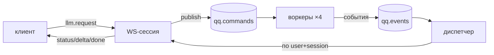

# cloud

Тонкий бэкенд QuipQuill: авторизация, шлюз к LLM и эмбеддингам (OpenRouter), очередь RabbitMQ + WebSocket. Игровой логики здесь нет. Протокол: [docs/architecture/protocol.md](../docs/architecture/protocol.md).

Стек: Python 3.13, uv, FastAPI, pydantic-settings, SQLAlchemy 2 + asyncpg + Alembic, PyJWT, pwdlib (argon2), aio-pika, openai SDK (OpenRouter), PostgreSQL 17, RabbitMQ 4.

## Запуск (из корня репозитория)

```bash
make infra-up       # Postgres :5432 + RabbitMQ :5672 (UI http://localhost:15672, quipquill/quipquill)
make cloud-migrate  # применить миграции Alembic к базе из DATABASE_URL
make cloud-dev      # API с автоперезагрузкой: http://127.0.0.1:8000/health, документация /docs
make cloud-test     # тесты; БД-тесты используют базу quipquill_test (создаётся автоматически)
make cloud-lint
```

Новая миграция после изменения моделей: `cd cloud && uv run alembic revision --autogenerate -m "<что>"`, затем проверить файл в `migrations/versions/`.

## Авторизация

Email + пароль, регистрация только по инвайт-коду (`INVITE_CODES`).

| Эндпоинт | Что |
|---|---|
| `POST /auth/register` `{email, password, invite_code}` | 201 → `{access_token, refresh_token, token_type, expires_in}`; 403 `invalid_invite_code`; 409 `email_taken` |
| `POST /auth/login` `{email, password}` | 200 → пара токенов; 401 `invalid_credentials` |
| `POST /auth/refresh` `{refresh_token}` | 200 → новая пара; старый refresh отзывается. Повтор уже отозванного → отзыв **всех** токенов пользователя, 401 `refresh_token_reused` |
| `GET /me` (Bearer) | `{id, email, tier, created_at, usage_today, limits: {daily_cost_usd}}` |

- Пароли — argon2id (`pwdlib`); email хранится в нижнем регистре.
- Access — JWT HS256 на 15 минут (`sub`, `tier`, `type=access`); ключ не короче 32 байт.
- Refresh — случайная строка на 30 дней; в БД только SHA-256.

Настройки читаются из переменных окружения и `cloud/.env` (шаблон — `.env.example`). Значения по умолчанию подходят для локальной инфраструктуры из `docker-compose.yml`. При `ENV=prod` сервис не стартует со стандартным `JWT_SECRET`.

## WebSocket и очереди

`ws://<host>/ws?token=<access JWT>` — контракт в [protocol.md](../docs/architecture/protocol.md).



- Всё в одном процессе (ADR 18): API, пул воркеров (`WORKER_CONCURRENCY`) и один диспетчер; поэтому сейчас поддерживается **один экземпляр API**.
- Сессия адресуется парой (пользователь из JWT, `sessionId`) — чужую сессию не подсмотреть.
- `resume` отдаёт текст текущих генераций (`replay`) и повторяет `done`, завершённые за последние `GENERATION_TTL_SECONDS`.
- Битая команда в очереди → `reject` без повтора; ошибка обработчика → событие `error` (`provider_error`) и `ack`.
- Нет RabbitMQ при старте → REST работает, `/ws` закрывается с кодом 1013.
- Обработчик — `OpenRouterHandler` (`LLM_HANDLER=openrouter`, по умолчанию) или `EchoHandler` (`echo`: стримит текст пользователя, для тестов и офлайн-разработки).

## LLM-шлюз (OpenRouter)

- Клиент — `openai` SDK с `base_url` OpenRouter; стрим с `include_usage`, вызовы инструментов собираются из дельт по `index`.
- Модель и лимиты — по тарифу, параметры — по `purpose` ([llm/policy.py](src/quipquill_cloud/llm/policy.py)). Прототип: у всех `free` → Haiku 5.5, **$0.05 в UTC-сутки** по стоимости, которую сообщает OpenRouter.
- Провайдеры: `{order: [amazon-bedrock, google-vertex/global], only: те же, allow_fallbacks: false}` — только без логов промптов, Bedrock первым: на нём кэш промпта читается со второго вызова (ADR 20).
- Каждый вызов (и эмбеддинги) → строка в `usage_events`; лимит проверяется **до** вызова модели.
- Таймаут на весь стрим — `LLM_TIMEOUT_SECONDS` (120 с); отмена закрывает стрим.
- `POST /embeddings` — только `EMBED_MODEL` (text-embedding-3-small).
- Живые тесты (стоят доли цента): `make cloud-test-live` — ключ берётся из `cloud/.env`.

## Структура `src/quipquill_cloud/`

| Пакет | Что | Этап |
|---|---|---|
| `main.py` | `create_app()`, подключение роутеров | 0.2 |
| `core/` | конфигурация (`Settings`), `security.py` — пароли, JWT, refresh-токены | 0.2, 2.1 |
| `api/` | `health`, `auth`, `me`, `ws` (WebSocket), `embeddings`, `deps` (текущий пользователь) | 0.2+ |
| `db/` | модели SQLAlchemy 2 (async, asyncpg), сессии; миграции — `cloud/migrations/` | 2.1 |
| `mq/` | `schemas` (протокол), `broker` (RabbitMQ), `worker` (команды → события, отмена), `dispatcher` (доставка, буфер для resume). Не `queue`, чтобы не путать со stdlib | 2.2 |
| `llm/` | `handler` (стрим OpenRouter → события), `policy` (модели, effort, лимиты), `usage` (учёт и лимит) | 2.3 |
