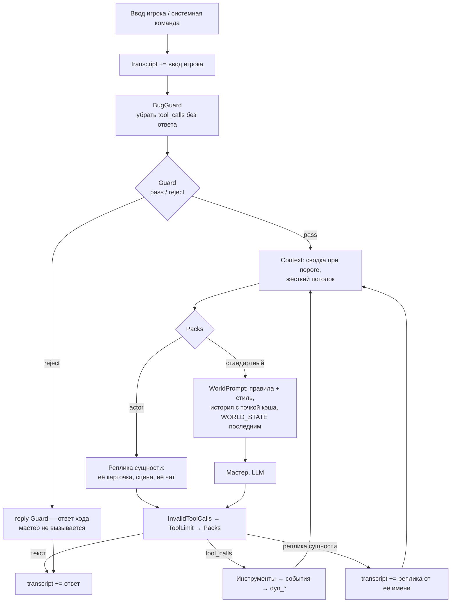
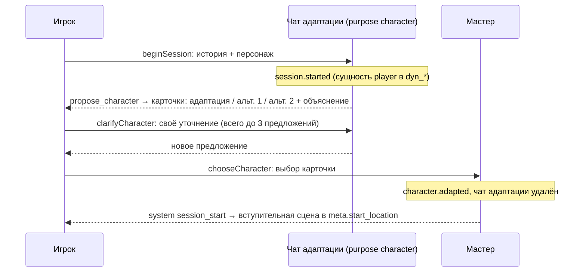

# Агент мастера

Один агент — мастер (Game Master) — работает на телефоне. Мир меняется только через инструменты. Реагировать может любая сущность рядом — NPC, существо, магический предмет: мастер даёт ей слово инструментом `react_entity`, и она говорит сама, в своём пузыре (ADR 33, 43, 45).

## Цепочка обработки хода



Порядок middleware (как в AI Samba: `before`-хуки по порядку, `after` — в обратном); код — `src/core/agent/middleware/`, сборка — `gm-agent.ts`:

| # | Middleware | Хук | Что делает |
|---|---|---|---|
| 1 | BugGuard | beforeAgent | Убирает вызовы инструментов без результата: у `AIMessage` остаются только отвеченные, пустое сообщение удаляется. История пишется по шагам, а ОС может закрыть приложение посреди вызова инструмента |
| 2 | Guard | beforeAgent | Только ввод игрока (системные команды и сводки — нет). Дешёвый вызов (`purpose: guard`, `responseFormat` = `GUARD_RESPONSE_FORMAT`): правила мира + WORLD STATE + последние слова мастера + ввод → JSON `{verdict, reason, reply}`. При `reject` `reply` — ответ хода, мастер не вызывается (ADR 35). Сбой проверки (сеть, лимит, таймаут 15 с, битый JSON) — ввод проходит (ADR 36). При `pass` — логичные упущения места под этот ввод (`expected`: только certain/likely, люди и обстановка, не больше двух) черновиками в граф до мастера; после хода (`afterAgent`) задействованный черновик остаётся, остальные удаляются (ADR 48). Видит последние записи разговора (10–19, окно сдвигается шагами по 10, отдельными блоками с точкой кэша — ADR 49), системный промпт — с TTL 1 час |
| 3 | Context | beforeModel | История ≥ 30K токенов (оценка: символы / 4) → старая часть сжимается в сводку дешёвой моделью (`purpose: summary`, таймаут 25 с, 2 попытки); при неудаче — отбрасывается с пометкой. Свежие ~8K токенов и текущий ход целиком остаются; разрез не отделяет результат от вызова. Жёсткий потолок истории — 85K (с промптом и инструментами — ниже 100K): старые ходы → укорачивание длинных результатов инструментов → разрез текущего хода. Идея — SafeSummarization из AI Samba (ADR 36) |
| 4 | ToolLimit | afterModel | Не больше 8 вызовов инструментов за ход: лишние получают ошибку вместо исполнения, модель просят ответить словами; продолжает вызывать — ход завершается (`cutShort`). Смотрит на последний ответ модели, даже если за ним уже стоят ошибки от InvalidToolCalls |
| 5 | InvalidToolCalls | afterModel | Вызовы с нечитаемыми аргументами → ошибка модели (этап 4.1) |
| 6 | Packs | wrapModelCall, afterModel | Пакеты (ADR 43, 45, 46): после `react_entity` — пакет **actor** (реплика сущности маленьким вызовом из её карточки и чата), затем мастер со стандартным промптом. Снаружи WorldPrompt. См. [ниже](#пакеты-мастера-actor-и-стандартный). Только если есть актёр |
| 7 | WorldPrompt | wrapModelCall | Системный промпт, точки кэша на истории, мир последним (см. ниже) |
| 8 | AfterTurn | afterAgent | После хода игрока — фоновая работа: генератор, затем `note_entity` (см. [генератор](#фоновый-генератор-мира-этап-62d-adr-42)). Последний в списке: условный spread в начале массива ломает вывод типов `createAgent` |

`transcript` пишет `runTurn()`, а не middleware: ввод игрока — сразу (системные команды не показываются), **каждый текст мастера — как только модель его написала** (в том числе текст рядом с вызовом инструмента; ответ Guard — с `extra.guard = "reject"`), реплики сущностей (пакет actor) — с `speaker = npc:<id>` и `extra.name`, в том порядке, в каком их видел игрок. `TurnResult.reply` — все тексты мастера за ход через пустую строку (без реплик сущностей). `model_messages` — рабочая память (сжимается, переписывается), `transcript` — только дописывается.

История мастера сохраняется **по шагам**: `runTurn()` читает поток состояний агента (`streamMode: "values"`) и после каждого шага пишет в `model_messages` только изменившееся (`ChatSync`: новые сообщения дописываются, хвост переписывается, если middleware заменил или удалил сообщения). Источник ввода (`player | system | summary`) и номер хода хранятся в `additional_kwargs` (`qq_source`, `qq_turn`) и провайдеру не уходят.

Один ход за раз: `runTurn`, `retryTurn` и шаги старта сессии держат блокировку партии (`turn-lock.ts`); второй вызов, пока идёт первый (двойное нажатие, повтор во время хода), сразу получает `TurnInProgressError`.

**Повтор хода** после сбоя (сеть, приложение закрыли) — `retryTurn()`, а не повторный `runTurn` с тем же текстом: ввод уже сохранён, агент продолжает с сохранённой истории (BugGuard чинит висящий вызов) под **тем же номером хода** (из `qq_turn`), так что события обеих попыток — один ход (важно для ADR 34). Если последний ход уже получил ответ — `NothingToRetryError`.

Что именно ловит Guard (наследник валидатора из старого прототипа): игрок объявляет факты мира («я вижу…», «у меня есть…», «я выпускаю огонь из пальцев») или действия, невозможные по состоянию. Сомнительные, но правдоподобные мелочи (снять плащ, оглядеться) — `pass`: с ними разбирается мастер через `add_entity`.

## Системный промпт

Промпты — **на английском**. Порядок запроса — от неизменного к меняющемуся, чтобы провайдер читал из кэша всё, кроме нового ([ADR 46](decisions.md#46-кэш-истории-мастера-мир--последним-system-сообщением-точка-кэша--в-конце-истории)):

```
[инструменты]               — неизменны (динамических нет)
[GM RULES] + [STORY STYLE]  — системный промпт: неизменен в рамках истории
──── точка кэширования 1 (TTL 1 час, ADR 49) ────
[история мастера]           — model_messages, как сохранена (реплики сущностей — «Name [id]: …»)
──── точка кэширования 2 ──── на последнем сообщении (и на последнем вводе/тексте, если последнее — результат инструмента)
[WORLD STATE]               — system-сообщение последним, пересобирается перед каждым вызовом, не сохраняется:
  Player: имя, раса, описание
  Location: имя + описание
  Exits: LEADS_TO (+ направление)
  Here: предметы и NPC в локации
  Inventory
  Open notes: заметки мастера
  Recent events: последние 5
```

Правила:
- Инструменты **не перечисляются** в тексте промпта — модель видит их описания (в старом `config.yaml` они дублировались).
- Описание инструмента — часть контракта с моделью наравне с промптом.
- Никаких временных меток или случайных ID до точек кэширования; в запросе ничего не вставляется в середину истории.
- Реализация: шаблон `GM_PROMPT` в `src/core/agent/prompt.ts` (`{{STORY_STYLE}}` заменяется), `gmSystemMessage` — одна часть с `cache_control: {type: "ephemeral"}`; `worldStateMessage` — `SystemMessage` с заголовком `# World state` и пометкой «от движка, не слова игрока, не упоминать». Собирает middleware `WorldPrompt` перед каждым вызовом модели; точки кэша на копиях сообщений ставит `withCacheBreakpoints` (`messages.ts`), в истории их нет. В `WORLD_STATE` у сущностей — id в квадратных скобках и описание, урезанное до 240 символов (полное — через `inspect`); у контейнеров — что внутри; события — короткими фразами с именами.

## Инструменты мастера

Общие инструменты мира — [ADR 43](decisions.md#43-актёры-вместо-чатов-npc-пакеты-мастера-общие-инструменты-мира) (этап 6.2f); реакции сущностей — `react_entity` и пакеты мастера (6.2g–6.2h2, ADR 45).

| Инструмент | Аргументы | Проверки | Событие |
|---|---|---|---|
| `inspect` | `target` | сущность видна (здесь, внутри контейнера здесь, в инвентаре, выход) — по id или имени; вне видимости — только по точному id (из `search_lore` или событий) | — |
| `search_lore` | `query` | — (векторный поиск по эмбеддингам истории и партии: переписанное ищется по новому тексту, не по старому, ADR 42; запрос — через облако) | — |
| `set_entity` | `id?, name?, type?, description?` | с `id` (или именем) — меняет переданные поля любой сущности, игрока тоже (`id: "player"`); тип не меняется, имя уникально, нужна хоть одна перемена. Без `id` — создаёт в текущей локации: нужны `name`, `type` (item·document·npc·creature·other), `description`; мест не создаёт | `entity.edited` / `entity.added` |
| `set_relation` | `a, relation, b, description?` | `located_in`: игрок — только по выходу из текущей локации; NPC или существо — в любую `LOCATION`; вещь из рук игрока — только сюда или в контейнер здесь; прочие вещи мастер переносит куда угодно; места не двигаются. `has_item`: игрок берёт переносимое и не `fixed` здесь (или в контейнере здесь), у NPC здесь — только после его `entity.reacted` в этом ходу (ADR 32, 34); другим — откуда угодно, из рук игрока — только тем, кто рядом. `interacts_with` / `has_attribute` — связь с описанием, переписывает связь того же типа между сторонами (в любую сторону). У вещи одно место: старое снимается само. `LEADS_TO` — нет | `player.moved`, `npc.moved`, `item.taken`, `item.dropped`, `item.moved`, `relation.set` |
| `cancel_relation` | `a, b` | между ними есть связи-отношения (`INTERACTS_WITH`, `HAS_ATTRIBUTE`); снимаются все, в обе стороны. По описанию — после `set_relation`, когда старая связь осталась неправдой | `relation.cancelled` |
| `note` | `text` или `close_id` | — | `note.added` / `note.closed` |
| `react_entity` | `target, situation` | цель существует и находится рядом или в инвентаре (не локация и не игрок) | `entity.reacted` — в пакете actor, после реплики |
| `roll_luck` | `attempt, likelihood, stakes` | бросок в коде (`src/core/agent/luck.ts`) по удаче истории (`meta.luck`); мастер получает исход — `success` / `failure` / `mishap` (только при удаче < 0,25) — и сам решает, что найдено или что пошло не так; рассказанное вносит генератор после ответа (ADR 47) | `luck.rolled` |

Код: [`src/core/agent/`](../../apps/mobile/src/core/agent/) — `prompt.ts` (промпт и WORLD STATE), `tools.ts`, `gm-agent.ts` (`createAgent` + middleware), `middleware/`, `chat-store.ts` (`model_messages`), `transcript.ts`, `run-turn.ts`; тестовый стенд — `testing/` (модель по сценарию).

Политика ошибок: инструмент **не бросает исключение**, а возвращает текст, начинающийся с `Error:` (правило мира или любой сбой, включая сеть у `search_lore`). Мастер пересказывает её в духе мира (как в старом промпте). Не больше 3 попыток починить одну и ту же ошибку.

Имена → ID: модель передаёт имя или ID; инструмент разрешает его нечётким поиском — сначала среди видимого (игрок тоже), потом по всему миру (`set_entity`, `set_relation`, `cancel_relation`: люди уходят и связаны с теми, кого нет рядом); если вариантов несколько — список кандидатов. Игрок — всегда `player`.

Гибкость сюжета (ADR 42): промпт требует сразу записывать, как выборы игрока меняют отношения людей (`set_relation` / `cancel_relation` для связей, `set_entity` — кем человек стал, что знает и хочет), перемещать уходящих людей через `set_relation` (`located_in`), даже за кадром, и делать реальным то, что честный персонаж сказал о мире (`set_entity`). Промпт NPC собирает его связи из `world_*`, поэтому NPC действует по новым связям и описанию, а не по задумке истории.

Исполнение:
- Вызовы инструментов одного ответа модели выполняются **по очереди, в порядке записи** (`move`, затем `take`): `createAgent` запускает их параллельно, поэтому инструменты мастера сериализованы.
- Вызов с аргументами, которые не разобрались как JSON-объект (`invalid_tool_calls` у `QueueChatModel`), `createAgent` сам не исполняет — ход закончился бы молча. Middleware `InvalidToolCalls` (`afterModel`) превращает его в обычный вызов с сырыми аргументами (`{invalid_arguments: "…"}`) и отвечает сообщением-ошибкой; если в ответе нет других вызовов — сразу снова к модели.
- `runTurn()`: история мастера из `model_messages` → ввод → цикл агента; мир меняется по ходу (каждый инструмент — своя транзакция), история сохраняется после каждого шага (с этапа 4.2), оборванный ход чинит BugGuard и продолжает `retryTurn()`.

## `react_entity` — реакция сущности (актёр)

[ADR 43](decisions.md#43-актёры-вместо-чатов-npc-пакеты-мастера-общие-инструменты-мира), [ADR 45](decisions.md#45-дешёвые-актёры-реплика-из-своего-чата-записки--в-фоне-честно-сказанное--генератор). Реагировать может **любая** сущность рядом или в инвентаре — человек, существо, магическое зеркало — на реплику, действие игрока или событие сцены, когда мастер решит, что реакция нужна.

1. Мастер вызывает `react_entity(target, situation)`. `situation` — что произошло **с точки зрения сущности**, во втором лице: «The stranger asks you about the vault», «The stranger grabs the brass key from your belt». Инструмент только проверяет цель (рядом или в инвентаре, не локация и не игрок) и отвечает «<name> [<id>] reacts now.» — модель не вызывается.
2. Следующий вызов — [пакет actor](#пакеты-мастера-actor-и-стандартный): сущность говорит сама.

### Пакеты мастера: actor и стандартный

Middleware `Packs` (`src/core/agent/middleware/packs.ts`, этапы 6.2h и 6.2h2) перед каждым вызовом модели определяет пакет **только по сообщениям текущего хода** (`packOf`), поэтому оборванный ход продолжается с того же места (`retryTurn`):

| Пакет | Когда | Вызов |
|---|---|---|
| стандартный | иначе (с начала хода и после реплик) | обычный вызов мастера; после реплики ничего не добавляется (ADR 46: префикс кэша не ломается) |
| **actor** | последний ответ мастера вызвал `react_entity`, все его вызовы получили результат, и у одной из сущностей ещё нет реплики | **свой маленький вызов**, мимо модели мастера: `actorModel(entity)` — `channel: npc:<id>`, `purpose: npc`, `meta.speaker` (интерфейс сразу рисует пузырь), без инструментов. Системный промпт `actorSystemMessage` (`src/core/agent/actor.ts`): стабильная часть с `cache_control` — «You are <name>…», описание (у NPC там характер), `props.persona`, связи, правила (от первого лица: слова в кавычках и/или действие в `*звёздочках*`, 1–3 предложения; знать только своё; мир не менять; неодушевлённое — ровно `[silence]`); изменчивая — записки («What you remember», последние 12), где находится (вещь — через того, кто несёт), кто рядом, что несёт, игрок перед ней. Сообщения — **чат сущности** (`model_messages`, `npc:<id>`, не больше 8K токенов с конца) + `situation` |

- После ответа актёра middleware (только в пакете actor) пишет событие `entity.reacted {entity, situation, reaction}` (молчание — `[silence]`), обмен — в чат сущности, а в историю мастера — `AIMessage` с `additional_kwargs.qq_actor = {id, name}`. `runTurn` пишет реплику в `transcript` от имени сущности (`speaker = npc:<id>`, `extra.name`; молчание не пишется). `afterModel` после реплики возвращает к модели; `isUnfinished` считает ход с репликой в конце незаконченным.
- Мастеру реплики показываются как `Name [id]: текст`, молчание — «Name [id] does not react.», сбой модели актёра — «Error: Name [id] could not react right now (…)» (события нет, ход не обрывается).
- Повтор хода: если реакция уже в журнале этого хода и последний обмен чата сущности — та же `situation`, реплика берётся из чата без нового вызова.
- Несколько `react_entity` в одном ответе — реплики по очереди, в порядке вызовов.
- **Память сущности** (`src/core/agent/entity-memory.ts`): окно чата — 4K токенов. После хода игрока, в фоне, после генератора (`Game`, замок хода; следующее действие ждёт) — для сущностей, реагировавших в этом ходу и вышедших за окно, один структурный запрос на всех (`purpose: summary`, канал `system`, `NOTE_ENTITY_RESPONSE_FORMAT` = `note_entity`): что каждая помнит и самые старые обмены → 1–3 записки от первого лица на сущность (`World.addActorNote`, событие `note.added` с `entity`); свёрнутые обмены убираются из чата (остаётся ~2K). Сбой запроса ничего не сворачивает.

### Черновики Guard (ADR 48)

Игрок обращается к тому, кого место подразумевает, но мир не показывает («прошу бармена налить»): Guard в `expected` предлагает его, код создаёт черновик (`props.draft`, `actor = 'guard'`) в текущей локации до мастера. В `WORLD_STATE` он помечен `just noticed`; правило мастера — использовать, если к месту, или не упоминать. Черновик может отреагировать (`react_entity`) в этом же ходу. После хода `afterAgent` Guard: черновик, который назвало событие хода или упомянул рассказ мастера, подтверждается (`draft.confirmed`), остальные удаляются из динамического графа целиком (`draft.withdrawn`).

### Предмет у NPC (ADR 32)

Отнять или выхватить предмет у NPC можно, но только **обыгранно**: мастер называет конкретный предмет, описывает попытку, вызывает `react_entity` (NPC сопротивляется, уступает, зовёт стражу…) и следующим ответом, после реплики, решает, удалась ли попытка. При успехе — `set_relation(player, has_item, <предмет>)`, событие `item.taken` с `from: <npc>`. Просто «взять» чужую вещь без попытки нельзя: нужен `entity.reacted` владельца в этом же ходу (ADR 34), поэтому `set_relation` раньше `react_entity` в одном ответе модели получает ошибку.

## Старт сессии и адаптация персонажа

Адаптация — **не работа мастера**: отдельный чат со своим промптом до начала игры (ADR 37). Код — `src/core/agent/character.ts` (чат и промпт) и `session.ts` (порядок шагов для интерфейса).



- **Шаги** (`session.ts`): `beginSession` → `session.started` и первое предложение (идемпотентно: после перезапуска вернёт ожидающее предложение); `clarifyCharacter(текст)` → новое предложение; `chooseCharacter(n)` (0 — адаптация, 1–2 — альтернативы) → `character.adapted` и `startStory`; `startStory` можно повторить отдельно, если сцена не открылась. Персонаж адаптируется один раз: `World.adaptCharacter` отказывает при повторе, двойное нажатие на карточку получает `TurnInProgressError` или `CharacterProposalError`. Уточнение игрока попадает в `transcript` только вместе с полученным предложением — неудачная попытка не оставляет строки.
- **Чат адаптации** — `model_messages(chat_id='character')`, пока игрок выбирает, после выбора удаляется. Системный промпт `CHARACTER_PROMPT`: `world_summary` + `world_constraints` + задача; первое сообщение — анкета игрока (имя, пол, возраст, раса, описание). Модель — `purpose: character`, канал `system`, ответ — структурный JSON `propose_character` (`CHARACTER_RESPONSE_FORMAT`): `adapted`, `alternatives` (лишние сверх двух отбрасываются), `rationale`; у персонажа — `name, race, age, description`. Нечитаемый ответ — `CharacterProposalError`, в чат и `transcript` ничего не пишется, шаг можно повторить.
- **Круги:** не больше 3 предложений; на третьем `canClarify = false`, уточнение отклоняется — только выбор карточки. Уточнение игрока Guard не проверяет: это пожелание к персонажу, а не действие в мире; баланс держит промпт адаптации через `world_constraints`.
- **`transcript`:** предложение — строка мастера с `extra = {kind: "character_proposal", round, options, canClarify}` (карточки для интерфейса 5.2), уточнение — строка игрока, выбор — строка игрока `extra = {kind: "character_choice", choice}`.
- **Выбор:** `character.adapted {original, adapted, choice}` меняет имя, описание, `props.race` и `props.age` игрока; исходная анкета остаётся в `props.original`.
- **Мастер пишет первым:** его первый ход — системная команда `[session_start]` с выбранным персонажем: выдать упомянутые в описании вещи (`add_entity`, в инвентарь) и открыть сцену в стартовой локации. Мастер чат адаптации не видит, Guard системную команду пропускает.

## Фоновый генератор мира (этап 6.2d, ADR 42)

После хода игрока мир догоняет то, что произошло: отдельный вызов (`purpose: generator`, канал `generator`, не история для игрока) со структурным ответом читает ход и записывает последствия — наследник `updator` старого прототипа. Код — `src/core/agent/generator.ts`, запуск — middleware `AfterTurn` (`middleware/after-turn.ts`, этап 6.2i), очередь фоновой работы — `BackgroundWork` (`background.ts`).

- **Когда:** `afterAgent` агента мастера — после хода игрока (и после повтора оборванного хода); не после вступления (системная команда) и не после отказа Guard. Middleware ставит работу в `BackgroundWork`: она стартует, когда ход отпустил замок (`released` в `turn-lock.ts`), — генератор, затем `note_entity` (ADR 45); оба держат замок хода. Игрок ответ не ждёт; следующее действие `Game` сначала ждёт фон (`whenGenerated` → `BackgroundWork.settle`) — не дольше `AFTER_TURN_TIMEOUT_MS` (30 с) на вызов, по таймауту вызов отменяется. `Game.close` отменяет фон (`cancel`). Стоимость фона `Game` прибавляет к стоимости хода после того, как ход досчитан. Когда генератор и `note_entity` отработали (не отменены), ход отмечается в `after_turns`; `Game.open` доделывает фон последнего хода игрока без отметки — приложение могли закрыть сразу после ответа (ADR 48).
- **Что видит** (стабильное — в начале, с точкой кэширования): правила `GENERATOR_PROMPT` + стиль истории; затем `WORLD_STATE`, «People involved» — NPC здесь и NPC из событий хода (до 8, с описанием, местом, связями с id и последними 5 записками — «Remembers», это их взгляд, а не факты мира), сам ход: ввод игрока, весь текст мастера, реплики сущностей, «Already recorded this turn» — события хода, чтобы не повторять мастера.
- **Что отвечает** (`GENERATOR_RESPONSE_FORMAT`, строгий JSON): `relations` (`a, b, description`), `cancelled` (`a, b`), `moves` (`who, to`), `edits` (`target, description` — целиком), `additions` (`name, type, description, where`; не места; `where` — место или контейнер, пусто — здесь). Обычно — пустые списки.
- **Несостыковки и удача** (ADR 45, 47): у каждого дополнения — `basis`. `narrated` — что ход сделал реальным: честно сказанное сущностью (мешок под лавкой, дверь в переулке — туда, где сказано; ложь и догадки — нет), находка по броску удачи или следствие неудачи, как их рассказал мастер (`where: "player"` — в руки игроку). `expected` — логичное упущение места (бармен в баре) с `likelihood`: добавляются только `certain` / `likely`, не больше двух за ход. Находок генератор сам не придумывает — в контексте «Luck this turn» с исходами бросков. Несуществующий `where` — отказ, ничего не создаётся.
- **Как применяется:** теми же командами мира, что инструменты мастера (`World.actingAs('generator')`: в журнале `actor = 'generator'`, номер хода — тот же), в порядке: отмены связей, связи, перемещения, описания, новое. Отказ мира (неизвестный id, игрок, «уже там») — не ошибка генератора: изменение отбрасывается, остальные применяются; отказы и сбои — в `console.warn` (журнал разработчика) и `Game.lastGeneration`, игрок их не видит. Нечитаемый ответ — `GeneratorAnswerError`, мир не меняется.
- **Стоимость:** входит в стоимость хода (`lastUsage`, канал `generator`); строка стоимости в dev-сборке дописывается, когда генератор закончил (`Game.onGenerated`). Статусы канала `generator` не включают индикатор «думает».

## Контекст и стоимость

- `model_messages` (рабочая память, сжимается) ≠ `transcript` (то, что видел игрок, только дописывается).
- Переживают сжатие: мир (`world_*`), `notes`, последние 5 событий — всё это в `WORLD_STATE`. Поэтому промпт требует **сразу** записывать важное через `note`, `edit_entity` и `update_player`.
- Стоимость хода считается по `usage` из `done` и показывается в отладочной панели (этап 6.1), вместе с генератором (6.2d).
