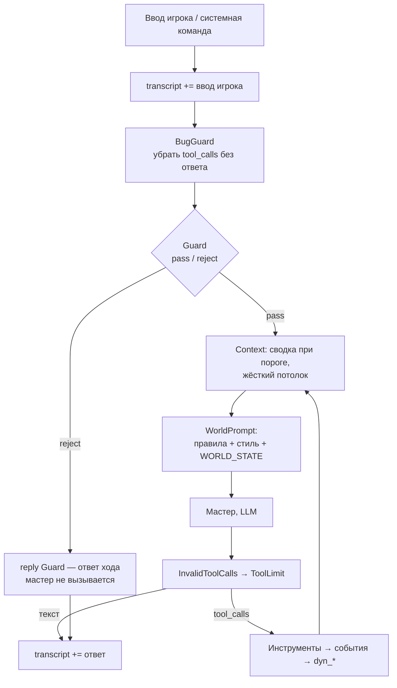
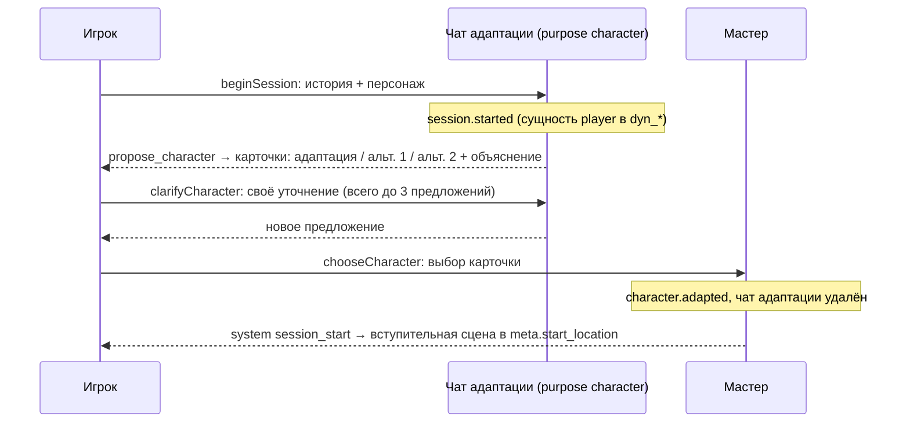

# Агент мастера

Один агент — мастер (Game Master) — работает на телефоне. Мир меняется только через инструменты. NPC — не отдельные агенты, а отдельные **чаты**, которые мастер вызывает инструментом `npc_react` (ADR 33).

## Цепочка обработки хода



Порядок middleware (как в AI Samba: `before`-хуки по порядку, `after` — в обратном); код — `src/core/agent/middleware/`, сборка — `gm-agent.ts`:

| # | Middleware | Хук | Что делает |
|---|---|---|---|
| 1 | BugGuard | beforeAgent | Убирает вызовы инструментов без результата: у `AIMessage` остаются только отвеченные, пустое сообщение удаляется. История пишется по шагам, а ОС может закрыть приложение посреди вызова инструмента |
| 2 | Guard | beforeAgent | Только ввод игрока (системные команды и сводки — нет). Дешёвый вызов (`purpose: guard`, `responseFormat` = `GUARD_RESPONSE_FORMAT`): правила мира + WORLD STATE + последние слова мастера + ввод → JSON `{verdict, reason, reply}`. При `reject` `reply` — ответ хода, мастер не вызывается (ADR 35). Сбой проверки (сеть, лимит, таймаут 15 с, битый JSON) — ввод проходит (ADR 36) |
| 3 | Context | beforeModel | История ≥ 30K токенов (оценка: символы / 4) → старая часть сжимается в сводку дешёвой моделью (`purpose: summary`, таймаут 25 с, 2 попытки); при неудаче — отбрасывается с пометкой. Свежие ~8K токенов и текущий ход целиком остаются; разрез не отделяет результат от вызова. Жёсткий потолок истории — 85K (с промптом и инструментами — ниже 100K): старые ходы → укорачивание длинных результатов инструментов → разрез текущего хода. Идея — SafeSummarization из AI Samba (ADR 36) |
| 4 | ToolLimit | afterModel | Не больше 8 вызовов инструментов за ход: лишние получают ошибку вместо исполнения, модель просят ответить словами; продолжает вызывать — ход завершается (`cutShort`). Смотрит на последний ответ модели, даже если за ним уже стоят ошибки от InvalidToolCalls |
| 5 | InvalidToolCalls | afterModel | Вызовы с нечитаемыми аргументами → ошибка модели (этап 4.1) |
| 6 | WorldPrompt | wrapModelCall | Собирает системный промпт перед каждым вызовом модели (см. ниже) |

`transcript` пишет `runTurn()`, а не middleware: ввод игрока — сразу (системные команды не показываются), **каждый текст мастера — как только модель его написала** (в том числе текст рядом с вызовом инструмента; ответ Guard — с `extra.guard = "reject"`), поэтому реплики NPC встают между ними в том порядке, в каком их видел игрок. `TurnResult.reply` — все тексты мастера за ход через пустую строку. `model_messages` — рабочая память (сжимается, переписывается), `transcript` — только дописывается.

История мастера сохраняется **по шагам**: `runTurn()` читает поток состояний агента (`streamMode: "values"`) и после каждого шага пишет в `model_messages` только изменившееся (`ChatSync`: новые сообщения дописываются, хвост переписывается, если middleware заменил или удалил сообщения). Источник ввода (`player | system | summary`) и номер хода хранятся в `additional_kwargs` (`qq_source`, `qq_turn`) и провайдеру не уходят.

Один ход за раз: `runTurn`, `retryTurn` и шаги старта сессии держат блокировку партии (`turn-lock.ts`); второй вызов, пока идёт первый (двойное нажатие, повтор во время хода), сразу получает `TurnInProgressError`.

**Повтор хода** после сбоя (сеть, приложение закрыли) — `retryTurn()`, а не повторный `runTurn` с тем же текстом: ввод уже сохранён, агент продолжает с сохранённой истории (BugGuard чинит висящий вызов) под **тем же номером хода** (из `qq_turn`), так что события обеих попыток — один ход (важно для ADR 34). Если последний ход уже получил ответ — `NothingToRetryError`.

Что именно ловит Guard (наследник валидатора из старого прототипа): игрок объявляет факты мира («я вижу…», «у меня есть…», «я выпускаю огонь из пальцев») или действия, невозможные по состоянию. Сомнительные, но правдоподобные мелочи (снять плащ, оглядеться) — `pass`: с ними разбирается мастер через `add_entity`.

## Системный промпт

Промпты — **на английском**. Сборка через замену маркеров (не `format`), порядок — от неизменного к меняющемуся, чтобы работал кэш промпта:

```
[GM RULES]                  — неизменно: роль, правила погружения, работа с инструментами
[STORY STYLE]               — {{STORY_STYLE}}: meta.style + world_summary (неизменно в рамках истории)
──── точка кэширования ────
[WORLD STATE]               — {{WORLD_STATE}}, пересобирается перед каждым вызовом:
  Player: имя, раса, описание
  Location: имя + описание
  Exits: LEADS_TO (+ направление)
  Here: предметы и NPC в локации
  Inventory
  Open notes: заметки мастера
  Recent events: последние 5
```

Правила:
- Инструменты **не перечисляются** в тексте промпта — модель видит их описания (в старом `config.yaml` они дублировались).
- Описание инструмента — часть контракта с моделью наравне с промптом.
- Никаких временных меток или случайных ID до точки кэширования.
- Реализация: шаблон `GM_PROMPT` в `src/core/agent/prompt.ts`. Системное сообщение — две текстовые части: стабильная (`[GM RULES]` + `[STORY STYLE]`) с `cache_control: {type: "ephemeral"}` и `WORLD_STATE`; пересобирается middleware `WorldPrompt` перед каждым вызовом модели. В `WORLD_STATE` у сущностей — id в квадратных скобках и описание, урезанное до 240 символов (полное — через `inspect`); у контейнеров — что внутри; события — короткими фразами с именами.

## Инструменты мастера

| Инструмент | Аргументы | Проверки | Событие |
|---|---|---|---|
| `move` | `to` (id или имя) | есть `LEADS_TO` из текущей локации | `player.moved` |
| `inspect` | `target` | сущность видна (здесь, внутри контейнера здесь, в инвентаре, выход) — по id или имени; вне видимости — только по точному id (из `search_lore` или событий) | — |
| `take` | `item` | предмет лежит здесь (или в контейнере здесь); предмет **у NPC рядом** — только если в этом ходу уже был его `npc.reacted` (ADR 32, 34) | `item.taken` |
| `drop` | `item` | предмет в инвентаре | `item.dropped` |
| `search_lore` | `query` | — (векторный поиск по эмбеддингам истории и партии: переписанное ищется по новому тексту, не по старому, ADR 42; запрос — через облако) | — |
| `add_entity` | `name, type (item·document·npc·creature·other), description, place (here·inventory)` | имя уникально; только в текущей локации или в руках игрока | `entity.added` |
| `edit_entity` | `target, description` (новое описание целиком) | сущность видна или задана точным id; не игрок | `entity.edited` |
| `update_player` | `description` (целиком) | — | `player.updated` |
| `note` | `text` или `close_id` | — | `note.added` / `note.closed` |
| `npc_react` | `target, situation` | цель существует и находится рядом | `npc.reacted` |
| `move_npc` | `who, to` (id или имя) | `who` — NPC или существо где угодно в мире, `to` — любая `LOCATION` (не только соседняя, ADR 42); не там же, где уже | `npc.moved` |
| `set_relation` | `a, b, description` | обе стороны существуют (где угодно, игрок тоже) и различны; описание не пустое. Уже есть связь между ними (в любую сторону) — переписывается её описание, иначе новая `a → b` типа `INTERACTS_WITH` | `relation.set` |
| `cancel_relation` | `a, b` | между ними есть связи-отношения (`INTERACTS_WITH`, `HAS_ATTRIBUTE`); снимаются все, в обе стороны | `relation.cancelled` |

Код: [`src/core/agent/`](../../apps/mobile/src/core/agent/) — `prompt.ts` (промпт и WORLD STATE), `tools.ts`, `gm-agent.ts` (`createAgent` + middleware), `middleware/`, `chat-store.ts` (`model_messages`), `transcript.ts`, `run-turn.ts`; тестовый стенд — `testing/` (модель по сценарию).

Политика ошибок: инструмент **не бросает исключение**, а возвращает текст, начинающийся с `Error:` (правило мира или любой сбой, включая сеть у `search_lore`). Мастер пересказывает её в духе мира (как в старом промпте). Не больше 3 попыток починить одну и ту же ошибку.

Имена → ID: модель передаёт имя или ID; инструмент разрешает его нечётким поиском среди видимых сущностей и, если вариантов несколько, возвращает список кандидатов. `move_npc`, `set_relation` и `cancel_relation` ищут по всему миру: люди уходят и связаны с теми, кого сейчас нет рядом.

Гибкость сюжета (ADR 42): промпт требует сразу записывать, как выборы игрока меняют отношения людей (`set_relation` / `cancel_relation` для связей, `edit_entity` — кем человек стал, что знает и хочет), и перемещать уходящих людей через `move_npc`, даже за кадром. Промпт NPC собирает его связи из `world_*`, поэтому NPC действует по новым связям и описанию, а не по задумке истории.

Исполнение:
- Вызовы инструментов одного ответа модели выполняются **по очереди, в порядке записи** (`move`, затем `take`): `createAgent` запускает их параллельно, поэтому инструменты мастера сериализованы.
- Вызов с аргументами, которые не разобрались как JSON-объект (`invalid_tool_calls` у `QueueChatModel`), `createAgent` сам не исполняет — ход закончился бы молча. Middleware `InvalidToolCalls` (`afterModel`) превращает его в обычный вызов с сырыми аргументами (`{invalid_arguments: "…"}`) и отвечает сообщением-ошибкой; если в ответе нет других вызовов — сразу снова к модели.
- `runTurn()`: история мастера из `model_messages` → ввод → цикл агента; мир меняется по ходу (каждый инструмент — своя транзакция), история сохраняется после каждого шага (с этапа 4.2), оборванный ход чинит BugGuard и продолжает `retryTurn()`.

## `npc_react` — реакция NPC

Общий инструмент вместо узкого `ask` (ADR 33): NPC реагирует на **любое** происходящее — на реплику, вопрос, действие игрока (толкнули, выхватили предмет, вошли без стука), на событие сцены — когда мастер решит, что реакция нужна.

1. Мастер вызывает `npc_react(target, situation)`. `situation` — что произошло **с точки зрения NPC**, во втором лице: «The stranger asks you about the vault», «The stranger tries to snatch the brass key from your belt». Цель — любая видимая сущность, кроме локаций и игрока (NPC, существо, добавленный мастером трактирщик, камень).
2. Инструмент собирает системный промпт NPC (`npcSystemMessage` в `src/core/agent/npc.ts`), две части:
   - стабильная, с `cache_control`: «You are <name>…», описание (`description` — у NPC демо-истории там же «Knows» и «Personality»), `props.persona`, связи в графе (`INTERACTS_WITH` и др. в обе стороны, с описанием связи), правила: реагируй от первого лица — словами в кавычках и/или действием в `*звёздочках*`, 1–3 предложения; знай только то, что знает персонаж; мир не меняй (решает мастер); неодушевлённое или нечего ответить — ровно `[silence]`;
   - сцена: где находится, кто ещё здесь, что несёт, игрок перед ним (имя, раса, описание).
3. История — свой чат `model_messages(chat_id='npc:<id>')` (у не-NPC — `npc:<id сущности>`, например `npc:item:crate`): `situation` — реплика пользователя, реакция — ответ. Чат держится маленьким без вызова сводки: от 6K токенов старое обрезается с пометкой для NPC «[You remember only the latest part of this conversation.]» (Context с `NPC_CONTEXT`).
4. Запрос уходит с `channel: "npc:<id>"`, `purpose: "npc"`, `meta.speaker` = имя, без инструментов (`queueModels(base).npcModel` в `src/core/agent/models.ts`). Интерфейс **сразу** рисует пузырь NPC со стримом.
5. Инструмент ждёт ответа (таймаут 60 с) и пишет по порядку: событие `npc.reacted` `{npc, situation, reaction}` (молчание — `[silence]`), обмен — в чат NPC, реакцию — в `transcript` (`speaker = npc:<id>`, `extra.name`; молчание не пишется). Журнал первым: реакция, которую видел игрок, всегда считается для правила ADR 34. Мастеру возвращается текст с напоминанием не повторять его (`[silence]` → «<NPC> does not react.»). Сбой модели NPC или записи события — ошибка текстом, ничего видимого не остаётся.
6. Правило мастера (раздел «People» промпта): кто-то рядом откликнулся бы — пусть реагирует через `npc_react`, а не репликами мастера; реакцию игрок уже видел — **не повторять и не пересказывать**, только последствия и сцена.

Несколько `npc_react` за ход выполняются **последовательно**, в порядке вызовов (инструменты мастера сериализованы); NPC узнаёт о предыдущей реакции, только если мастер опишет её в `situation`.

### Предмет у NPC (ADR 32)

Отнять или выхватить предмет у NPC можно, но только **обыгранно**: мастер называет конкретный предмет, описывает попытку, вызывает `npc_react` (NPC сопротивляется, уступает, зовёт стражу…) и по итогу решает, удалась ли она. При успехе — `take(<этот предмет>)`, событие `item.taken` с `from: <npc>`. Просто «взять» чужую вещь без попытки нельзя: `take` требует `npc.reacted` владельца в этом же ходу (ADR 34), поэтому `take` раньше `npc_react` в одном ответе модели получает ошибку.

## Старт сессии и адаптация персонажа

Адаптация — **не работа мастера**: отдельный чат со своим промптом до начала игры (ADR 37). Код — `src/core/agent/character.ts` (чат и промпт) и `session.ts` (порядок шагов для интерфейса).



- **Шаги** (`session.ts`): `beginSession` → `session.started` и первое предложение (идемпотентно: после перезапуска вернёт ожидающее предложение); `clarifyCharacter(текст)` → новое предложение; `chooseCharacter(n)` (0 — адаптация, 1–2 — альтернативы) → `character.adapted` и `startStory`; `startStory` можно повторить отдельно, если сцена не открылась. Персонаж адаптируется один раз: `World.adaptCharacter` отказывает при повторе, двойное нажатие на карточку получает `TurnInProgressError` или `CharacterProposalError`. Уточнение игрока попадает в `transcript` только вместе с полученным предложением — неудачная попытка не оставляет строки.
- **Чат адаптации** — `model_messages(chat_id='character')`, пока игрок выбирает, после выбора удаляется. Системный промпт `CHARACTER_PROMPT`: `world_summary` + `world_constraints` + задача; первое сообщение — анкета игрока (имя, пол, возраст, раса, описание). Модель — `purpose: character`, канал `system`, ответ — структурный JSON `propose_character` (`CHARACTER_RESPONSE_FORMAT`): `adapted`, `alternatives` (лишние сверх двух отбрасываются), `rationale`; у персонажа — `name, race, age, description`. Нечитаемый ответ — `CharacterProposalError`, в чат и `transcript` ничего не пишется, шаг можно повторить.
- **Круги:** не больше 3 предложений; на третьем `canClarify = false`, уточнение отклоняется — только выбор карточки. Уточнение игрока Guard не проверяет: это пожелание к персонажу, а не действие в мире; баланс держит промпт адаптации через `world_constraints`.
- **`transcript`:** предложение — строка мастера с `extra = {kind: "character_proposal", round, options, canClarify}` (карточки для интерфейса 5.2), уточнение — строка игрока, выбор — строка игрока `extra = {kind: "character_choice", choice}`.
- **Выбор:** `character.adapted {original, adapted, choice}` меняет имя, описание, `props.race` и `props.age` игрока; исходная анкета остаётся в `props.original`.
- **Мастер пишет первым:** его первый ход — системная команда `[session_start]` с выбранным персонажем: выдать упомянутые в описании вещи (`add_entity`, в инвентарь) и открыть сцену в стартовой локации. Мастер чат адаптации не видит, Guard системную команду пропускает.

## Контекст и стоимость

- `model_messages` (рабочая память, сжимается) ≠ `transcript` (то, что видел игрок, только дописывается).
- Переживают сжатие: мир (`world_*`), `notes`, последние 5 событий — всё это в `WORLD_STATE`. Поэтому промпт требует **сразу** записывать важное через `note`, `edit_entity` и `update_player`.
- Стоимость хода считается по `usage` из `done` и показывается в отладочной панели (этап 6.1).
