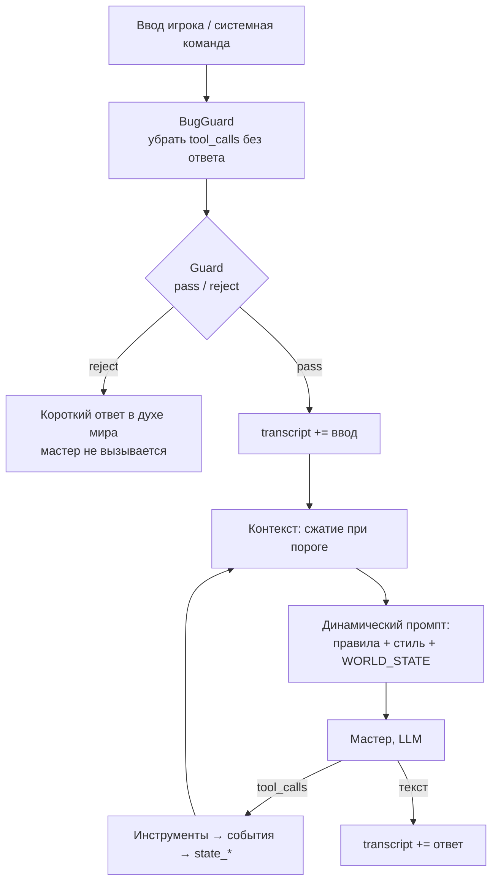
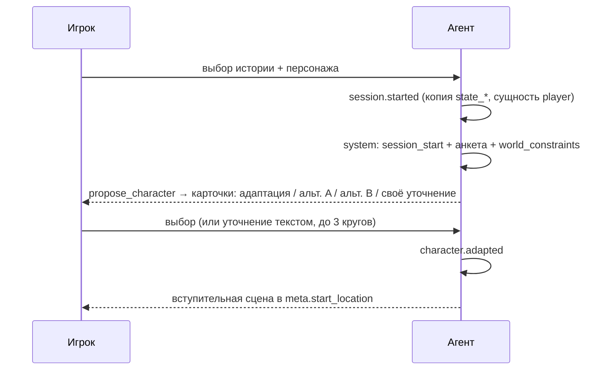

# Агент мастера

Один агент — мастер (Game Master) — работает на телефоне. Мир меняется только через инструменты. NPC — не отдельные агенты, а отдельные **чаты**, которые мастер вызывает инструментом `npc_react` (ADR 33).

## Цепочка обработки хода



Порядок middleware (как в AI Samba: `before`-хуки по порядку, `after` — в обратном):

| # | Middleware | Хук | Что делает |
|---|---|---|---|
| 1 | BugGuard | beforeAgent | Если история заканчивается `AIMessage` с `tool_calls` без ответа — удаляет его. На телефоне ОС может закрыть приложение посреди вызова инструмента |
| 2 | Guard | beforeAgent | Системные сообщения пропускает. Для ввода игрока — дешёвый вызов (`purpose: guard`, effort `low`, JSON `{verdict, reason}`). При `reject` — ответ в духе мира без вызова мастера |
| 3 | Transcript | beforeAgent / afterAgent | Пишет ввод и итоговый ответ в `transcript` |
| 4 | Context | beforeModel | Порог ~30K токенов → сжатие старой части в сводку (безопасная точка разреза: пара «вызов → результат» не разрывается); при неудаче — обрезка с пометкой. Жёсткий потолок < 100K (выше этого Haiku в 5 раз дороже) |
| 5 | Dynamic prompt | перед каждым вызовом модели | Собирает системный промпт (см. ниже) |
| — | Лимит итераций | цикл агента | Не больше 8 вызовов инструментов за ход |

Что именно ловит Guard (наследник валидатора из старого прототипа): игрок объявляет факты мира («я вижу…», «у меня есть…», «я выпускаю огонь из пальцев») или действия, невозможные по состоянию. Сомнительные, но правдоподобные мелочи (снять плащ, оглядеться) — `pass`: с ними разбирается мастер через `add_entity`.

## Системный промпт

Промпты — **на английском**. Сборка через замену маркеров (не `format`), порядок — от неизменного к меняющемуся, чтобы работал кэш промпта:

```
[GM RULES]                  — неизменно: роль, правила погружения, работа с инструментами
[STORY STYLE]               — {{STORY_STYLE}}: meta.style + world_summary (неизменно в рамках истории)
──── точка кэширования ────
[WORLD STATE]               — {{WORLD_STATE}}, пересобирается перед каждым вызовом:
  Player: имя, раса, описание
  Location: имя + описание
  Exits: LEADS_TO (+ направление)
  Here: предметы и NPC в локации
  Inventory
  Open notes: заметки мастера
  Recent events: последние 5
```

Правила:
- Инструменты **не перечисляются** в тексте промпта — модель видит их описания (в старом `config.yaml` они дублировались).
- Описание инструмента — часть контракта с моделью наравне с промптом.
- Никаких временных меток или случайных ID до точки кэширования.
- Реализация: шаблон `GM_PROMPT` в `src/core/agent/prompt.ts`. Системное сообщение — две текстовые части: стабильная (`[GM RULES]` + `[STORY STYLE]`) с `cache_control: {type: "ephemeral"}` и `WORLD_STATE`; пересобирается middleware `WorldPrompt` перед каждым вызовом модели. В `WORLD_STATE` у сущностей — id в квадратных скобках и описание, урезанное до 240 символов (полное — через `inspect`); у контейнеров — что внутри; события — короткими фразами с именами.

## Инструменты мастера

| Инструмент | Аргументы | Проверки | Событие |
|---|---|---|---|
| `move` | `to` (id или имя) | есть `LEADS_TO` из текущей локации | `player.moved` |
| `inspect` | `target` | сущность видна (здесь, внутри контейнера здесь, в инвентаре, выход) — по id или имени; вне видимости — только по точному id (из `search_lore` или событий) | — |
| `take` | `item` | предмет лежит здесь (или в контейнере здесь); предмет **у NPC рядом** — только если в этом ходу уже был его `npc.reacted` (ADR 32, 34) | `item.taken` |
| `drop` | `item` | предмет в инвентаре | `item.dropped` |
| `search_lore` | `query` | — (векторный поиск по эмбеддингам истории, запрос — через облако) | — |
| `add_entity` | `name, type (item·document·npc·creature·other), description, place (here·inventory)` | имя уникально; только в текущей локации или в руках игрока | `entity.added` |
| `edit_entity` | `target, description` (новое описание целиком) | сущность видна или задана точным id; не игрок | `entity.edited` |
| `update_player` | `description` (целиком) | — | `player.updated` |
| `note` | `text` или `close_id` | — | `note.added` / `note.closed` |
| `npc_react` | `target, situation` | цель существует и находится рядом | `npc.reacted` |
| `propose_character` | `adapted, alternatives[≤2], rationale` | только во время старта сессии | (после выбора) `character.adapted` |

Код: [`src/core/agent/`](../../apps/mobile/src/core/agent/) — `prompt.ts` (промпт и WORLD STATE), `tools.ts`, `gm-agent.ts` (`createAgent` + middleware), `chat-store.ts` (`model_messages`), `run-turn.ts`; тестовый стенд — `testing/` (модель по сценарию).

Политика ошибок: инструмент **не бросает исключение**, а возвращает текст, начинающийся с `Error:` (правило мира или любой сбой, включая сеть у `search_lore`). Мастер пересказывает её в духе мира (как в старом промпте). Не больше 3 попыток починить одну и ту же ошибку.

Имена → ID: модель передаёт имя или ID; инструмент разрешает его нечётким поиском среди видимых сущностей и, если вариантов несколько, возвращает список кандидатов.

Исполнение:
- Вызовы инструментов одного ответа модели выполняются **по очереди, в порядке записи** (`move`, затем `take`): `createAgent` запускает их параллельно, поэтому инструменты мастера сериализованы.
- Вызов с аргументами, которые не разобрались как JSON-объект (`invalid_tool_calls` у `QueueChatModel`), `createAgent` сам не исполняет — ход закончился бы молча. Middleware `InvalidToolCalls` (`afterModel`) превращает его в обычный вызов с сырыми аргументами (`{invalid_arguments: "…"}`) и отвечает сообщением-ошибкой; если в ответе нет других вызовов — сразу снова к модели.
- `runTurn()`: история мастера из `model_messages` → ввод игрока → цикл агента → сообщения хода дописываются в `model_messages`. Мир меняется по ходу (каждый инструмент — своя транзакция), история сохраняется только по завершении хода; оборванный ход — забота BugGuard (4.2).

## `npc_react` — реакция NPC

Общий инструмент вместо узкого `ask` (ADR 33): NPC реагирует на **любое** происходящее — на реплику, вопрос, действие игрока (толкнули, выхватили предмет, вошли без стука), на событие сцены — когда мастер решит, что реакция нужна.

1. Мастер вызывает `npc_react(target, situation)`. `situation` — что произошло **с точки зрения NPC**: «The stranger asks you about the vault», «The stranger tries to snatch the brass key from your belt».
2. Инструмент собирает промпт NPC:
   - персона из сущности (`description`, `props.persona`);
   - соседи в графе: где находится, что у него есть, с кем связан;
   - правило: реагируй от первого лица — словами и/или действием; знай только то, что знает персонаж; если сущность неодушевлённая или реагировать не на что — верни `[silence]`.
3. `situation` добавляется в `model_messages(chat_id='npc:<id>')` как реплика пользователя.
4. Запрос уходит с `channel: "npc:<id>"`, `purpose: "npc"`, `meta.speaker`. Интерфейс **сразу** рисует пузырь NPC со стримом.
5. Инструмент ждёт `done`, сохраняет реакцию в чат NPC и `transcript`, пишет событие `npc.reacted` `{npc, situation, reaction}` и возвращает мастеру текст реакции (`[silence]` → «<NPC> не реагирует»).
6. Правило мастера: реакцию NPC игрок уже видел — **не повторять её дословно**, только описать последствия и сцену.

Несколько `npc_react` за ход выполняются **последовательно** (NPC может отреагировать на предыдущего).

### Предмет у NPC (ADR 32)

Отнять или выхватить предмет у NPC можно, но только **обыгранно**: мастер называет конкретный предмет, описывает попытку, вызывает `npc_react` (NPC сопротивляется, уступает, зовёт стражу…) и по итогу решает, удалась ли она. При успехе — `take(<этот предмет>)`, событие `item.taken` с `from: <npc>`. Просто «взять» чужую вещь без попытки нельзя.

## Старт сессии и адаптация персонажа



- Мастер пишет первым: ход запускается системной командой `session_start`, Guard её пропускает.
- Анкета: имя, пол, возраст, раса, описание. Исходная анкета сохраняется в `props.original` сущности игрока.
- Адаптация — под `world_constraints`: эпоха, допустимые расы, уровень магии и технологий, баланс («полубог с легендарным мечом» → сильные стороны приглушены).

## Контекст и стоимость

- `model_messages` (рабочая память, сжимается) ≠ `transcript` (то, что видел игрок, только дописывается).
- Переживают сжатие: `state_*`, `notes`, последние 5 событий — всё это в `WORLD_STATE`. Поэтому промпт требует **сразу** записывать важное через `note`, `edit_entity` и `update_player`.
- Стоимость хода считается по `usage` из `done` и показывается в отладочной панели (этап 6.1).
