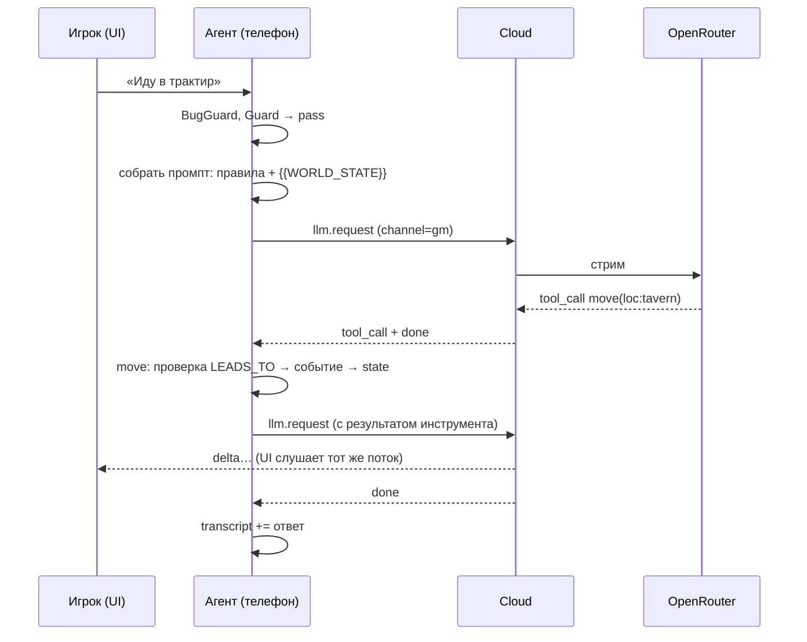

# Архитектура прототипа

QuipQuill — интерактивная книга (пока только текст) с ИИ-мастером. Мир истории — типизированный граф (локации, предметы, NPC, связи). Мастер — LLM-агент, который меняет мир **только через инструменты** и рассказывает игроку, что произошло.

## Главный принцип

> Состояние мира живёт в графе, а не в памяти модели. LLM — рассказчик и интерпретатор намерений, а не источник истины.

## Компоненты

```mermaid
graph LR
  subgraph Phone["Телефон (Expo, TypeScript)"]
    UI[UI: экраны, чат]
    CORE["Ядро src/core:<br/>агент мастера, инструменты,<br/>мир, журнал событий"]
    DB[(SQLite op-sqlite:<br/>история + сохранение)]
    UI <--> CORE
    CORE <--> DB
  end
  subgraph Cloud["Облако (FastAPI, Python)"]
    WS[WS /ws]
    MQ[(RabbitMQ<br/>qq.commands / qq.events)]
    W[LLM-воркер]
    PG[(PostgreSQL:<br/>users, usage)]
    WS --> MQ --> W
    W --> MQ --> WS
    W --> PG
  end
  OR[[OpenRouter:<br/>Haiku 5.5, эмбеддинги]]
  B[Builder (Python):<br/>лор → граф → .qqstory]
  CORE <-->|llm.request / события| WS
  W --> OR
  B -->|файл .qqstory| DB
  B --> OR
```

| Компонент | Где | Ответственность |
|---|---|---|
| **Мобильное приложение** | `apps/mobile` | Интерфейс, агент мастера, мир, сохранения. Всё игровое состояние хранится локально |
| **Ядро** | `apps/mobile/src/core` | Чистый TypeScript без импортов React Native: агент, инструменты, репозиторий мира, протокол. Тестируется в Node, позже выносится в отдельный пакет для десктопа |
| **Cloud** | `cloud/` | Авторизация, шлюз к LLM и эмбеддингам (модель, лимиты, учёт токенов), очередь сообщений. **Игровой логики в облаке нет** |
| **Builder** | `builder/` | Офлайн-скрипт: лор → граф (LLM-экстрактор) → `.qqstory` (SQLite + эмбеддинги + meta). Запускается локально или в Docker рядом с облаком |
| **Истории** | `stories/` | Исходные тексты и собранные `.qqstory` |

## Ход игрока (упрощённо)



Подробнее: [agent.md](agent.md), [protocol.md](protocol.md), [data-model.md](data-model.md).

## Структура репозитория

```
QuipQuill/
├── CLAUDE.md                # правила для Claude Code
├── docker-compose.yml       # Postgres + RabbitMQ (+ cloud) — этап 0.2
├── apps/
│   └── mobile/              # Expo SDK 57, TypeScript
│       └── src/
│           ├── app/         # экраны (Expo Router)
│           ├── components/
│           ├── core/        # ядро без RN (тесты в Node): storage/, story/, vector/, library/,
│           │                #   world/, protocol/, net/, util/; agent/ — фаза 4
│           └── platform/    # адаптеры портов: op-sqlite, expo-file-system, secure-store, полифилы;
│                            #   node/ — node:sqlite и node:fs для тестов и будущего десктопа
├── cloud/                   # FastAPI, uv
├── builder/                 # экстрактор + экспорт, uv
├── prompts/                 # оригиналы промптов LLM; в прод — переменными CI, в приложение не идут (ADR 57)
├── schema/
│   └── story.sql            # единая схема .qqstory
├── stories/                 # демо-истории
└── docs/
    ├── plan/                # roadmap, backlog
    ├── architecture/        # этот раздел
    └── notes/               # исследования, legacy, настройка окружения
```

## Чего в прототипе нет

Кооператив, тарифы и оплата, библиотека историй, создание историй пользователями, десктоп, JEV, голос. Всё это — в [backlog](../plan/backlog.md).
