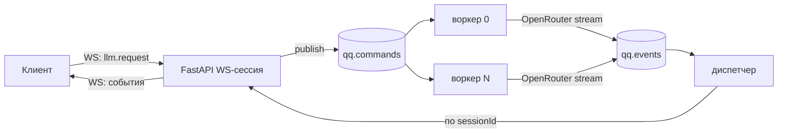

# Протокол клиент ↔ облако

Транспорт — WebSocket `wss://<host>/ws?token=<access_jwt>`, внутри облака — RabbitMQ. Паттерн взят из AI Samba ([notes/ai-samba-ideas.md](../notes/ai-samba-ideas.md)), но **команда — это запрос к LLM**, а не сообщение пользователя: агент работает на телефоне.

## Топология



- Две общие durable-очереди, `sessionId` внутри сообщения. Префикс окружения: `qq`, `qq.staging`…
- `userId` и `tier` подставляет **сервер** из JWT, клиенту они не доверяются.
- Воркеры конкурируют (`prefetch=1`), диспетчер один на процесс.
- Ошибка обработки → событие `error` + `ack` (без повтора). Битый JSON → `reject(requeue=False)`.

## Конверт

Все сообщения — JSON с полем `v` (версия протокола, сейчас `1`).

### Клиент → сервер

```jsonc
// Запрос к модели
{
  "v": 1, "type": "llm.request",
  "requestId": "c0ffee…",          // генерирует клиент (uuid)
  "sessionId": "save-uuid",        // id сохранения/партии
  "channel": "gm",                 // gm | npc:<id> | guard | system — куда UI рисует поток
  "purpose": "gm",                 // gm | guard | npc | summary | character — сервер выбирает модель/лимиты
  "messages": [ /* OpenAI-совместимые сообщения */ ],
  "tools": [ /* JSON Schema инструментов */ ],
  "responseFormat": null,          // JSON Schema для структурного ответа (guard)
  "meta": { "speaker": "Innkeeper" }  // для UI: подпись говорящего
}

{ "v": 1, "type": "resume", "sessionId": "save-uuid" }   // после переподключения
{ "v": 1, "type": "cancel", "requestId": "c0ffee…" }
{ "v": 1, "type": "ping" }
```

Ограничения (проверяет сервер): размер `messages` (байты и оценка токенов), число инструментов, частота запросов на пользователя, суточный лимит токенов тарифа.

### Сервер → клиент

```jsonc
{ "v":1, "type":"status",    "requestId":"…", "sessionId":"…", "channel":"gm", "status":"queued|thinking" }
{ "v":1, "type":"delta",     "requestId":"…", "sessionId":"…", "channel":"npc:innkeeper", "seq":12, "text":"Well, tra" }
{ "v":1, "type":"tool_call", "requestId":"…", "sessionId":"…", "channel":"gm",
  "call": { "id":"call_1", "name":"move", "arguments":"{\"to\":\"loc:tavern\"}" } }
{ "v":1, "type":"done",      "requestId":"…", "sessionId":"…", "channel":"gm",
  "message": { "role":"assistant", "content":"…", "tool_calls":[…] },   // итог, источник истины
  "finishReason":"stop|tool_calls|length",
  "usage": { "input":1234, "output":210, "cacheRead":900, "costUsd":0.00023 } }
{ "v":1, "type":"error",     "requestId":"…", "sessionId":"…", "code":"limit_exceeded|provider_error|timeout|bad_request",
  "statusKey":"error.limit", "retryable":false }
{ "v":1, "type":"replay",    "requestId":"…", "sessionId":"…", "channel":"gm", "text":"<весь накопленный текст>" }
{ "v":1, "type":"heartbeat" }
```

Правила:
- `delta.seq` растёт внутри `requestId`. Клиент отбрасывает дубликаты и события чужих `requestId`.
- **`done.message` — источник истины** для агента. Дельты нужны только интерфейсу. `QueueChatModel` ждёт `done`.
- `tool_call` отправляется, когда вызов собран целиком (дельты аргументов инструмента клиенту не идут).
- `replay` **заменяет** показанный текст, а не дописывается к нему.
- Если команду не удалось положить в очередь, приходит `error` без предшествующего `status`.
- `statusKey` — ключ строки интерфейса (локализация на клиенте).

## Буфер активной генерации и resume

Диспетчер хранит по `sessionId` активные запросы: `{requestId, channel, text, startedAt}` с TTL 900 с. При `resume`:

| Состояние | Ответ |
|---|---|
| Генерация идёт, текст есть | `replay` с текущим текстом, дальше живой поток |
| Генерация идёт, текста нет | `status: thinking` |
| Ничего не идёт, но последний `done` был < TTL назад | повтор `done` (на случай, если клиент его потерял) |
| Ничего | только подписка |

Показ replay и регистрация подписчика — под одним локом, чтобы событие не потерялось и не задвоилось.

## Эмбеддинги (REST)

`POST /embeddings` `{ "model": "<из meta.embed_model>", "input": ["…", "…"] }` → `{ "vectors": [[…], …], "usage": {…} }`. Модель проверяется по белому списку на сервере.

## Авторизация (REST)

`POST /auth/register` `{email, password, invite_code}`, `POST /auth/login` → `{access_token, refresh_token, token_type, expires_in}`; `POST /auth/refresh` `{refresh_token}` (ротация); `GET /me` → `{id, email, tier, created_at, usage_today}` (лимиты тарифа — с этапа 2.3). Подробности — [cloud/README.md](../../cloud/README.md#авторизация).
