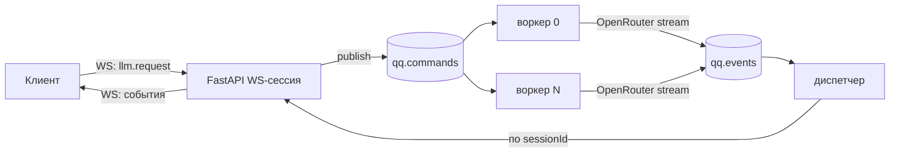

# Протокол клиент ↔ облако

Транспорт — WebSocket `wss://<host>/ws`, токен — в первом сообщении `auth` ([ADR 22](decisions.md#22-авторизация-websocket-первым-сообщением)), внутри облака — RabbitMQ. Паттерн взят из AI Samba ([notes/ai-samba-ideas.md](../notes/ai-samba-ideas.md)), но **команда — это запрос к LLM**, а не сообщение пользователя: агент работает на телефоне.

## Топология



- Две общие durable-очереди, `sessionId` внутри сообщения. Префикс окружения: `qq`, `qq.staging`…
- `userId` и `tier` подставляет **сервер** из JWT, клиенту они не доверяются.
- Воркеры конкурируют (`prefetch=1`), диспетчер один на процесс.
- Ошибка обработки → событие `error` + `ack` (без повтора). Битый JSON → `reject(requeue=False)`.

## Конверт

Все сообщения — JSON с полем `v` (версия протокола, сейчас `1`).

### Подключение

```jsonc
// 1. Клиент открывает /ws (без токена в URL) и первым сообщением шлёт:
{ "v": 1, "type": "auth", "token": "<access_jwt>" }
// 2. Сервер отвечает:
{ "v": 1, "type": "ready" }
// Только после ready клиент шлёт остальное (и resume своих сессий после переподключения).
```

Без валидного `auth` первым сообщением в течение `WS_AUTH_TIMEOUT` (10 с) сокет закрывается с кодом **4401** — клиент обновляет access-токен и переподключается. Если очередь недоступна — **1013** сразу после подключения. Токен в URL (`?token=`) не принимается: строка запроса попадает в логи uvicorn и прокси. Срок access-токена проверяется только при `auth`: открытый сокет живёт и после его истечения.

### Клиент → сервер

```jsonc
// Запрос к модели
{
  "v": 1, "type": "llm.request",
  "requestId": "c0ffee…",          // генерирует клиент (uuid)
  "sessionId": "save-uuid",        // id сохранения/партии
  "channel": "gm",                 // gm | npc:<id> | guard | system | generator — куда UI рисует поток
  "model": "basic",                // класс модели (ADR 50): модель и провайдеров выбирает облако; не задан — basic
  "purpose": "gm",                 // gm | guard | npc | summary | character | generator — сервер выбирает модель/лимиты
  "messages": [ /* OpenAI-совместимые сообщения */ ],
  "tools": [ /* JSON Schema инструментов */ ],
  "responseFormat": null,          // JSON Schema для структурного ответа (guard)
  "meta": { "speaker": "Innkeeper" }  // для UI: подпись говорящего
}

{ "v": 1, "type": "resume", "sessionId": "save-uuid" }   // после переподключения
{ "v": 1, "type": "cancel", "requestId": "c0ffee…" }
{ "v": 1, "type": "ping" }
```

Ограничения (проверяет сервер): сообщение ≤ 1 МБ; `messages` ≤ ~95K токенов (оценка: символы / 4); ≤ 32 инструментов; 30 запросов в минуту на пользователя (всплеск 10); дневной лимит тарифа.


### Сервер → клиент

```jsonc
{ "v":1, "type":"ready" }   // ответ на auth
{ "v":1, "type":"status",    "requestId":"…", "sessionId":"…", "channel":"gm", "status":"queued|thinking" }
{ "v":1, "type":"delta",     "requestId":"…", "sessionId":"…", "channel":"npc:innkeeper", "seq":12, "text":"Well, tra" }
{ "v":1, "type":"tool_call", "requestId":"…", "sessionId":"…", "channel":"gm",
  "call": { "id":"call_1", "name":"move", "arguments":"{\"to\":\"loc:tavern\"}" } }
{ "v":1, "type":"done",      "requestId":"…", "sessionId":"…", "channel":"gm",
  "message": { "role":"assistant", "content":"…" | null, "tool_calls":[…] },   // итог, источник истины
  "finishReason":"stop|tool_calls|length|cancelled",
  "usage": { "input":1234, "output":210, "cacheRead":900, "cacheWrite":0, "costUsd":0.00023 } }
{ "v":1, "type":"error",     "requestId":"…", "sessionId":"…", "code":"limit_exceeded|provider_error|timeout|bad_request",
  "statusKey":"error.limit", "retryable":false }
{ "v":1, "type":"replay",    "requestId":"…", "sessionId":"…", "channel":"gm", "text":"<весь накопленный текст>" }
{ "v":1, "type":"heartbeat" }
```

Правила:
- `delta.seq` растёт внутри `requestId`. Клиент отбрасывает дубликаты и события чужих `requestId`.
- **`done.message` — источник истины** для агента. Дельты нужны только интерфейсу. `QueueChatModel` ждёт `done`.
- `tool_call` отправляется, когда вызов собран целиком (дельты аргументов инструмента клиенту не идут).
- `replay` **заменяет** показанный текст, а не дописывается к нему.
- Если команду не удалось положить в очередь, приходит `error` (`queue_unavailable`) без предшествующего `status`.
- Невалидное сообщение клиента → `error` с `code: "bad_request"` (слишком большое — `message_too_large`), сокет **не** закрывается.
- `cancel` останавливает генерацию между дельтами: приходит `done` с `finishReason: "cancelled"` и тем текстом, что успел сгенерироваться.
- `heartbeat` приходит, только пока в подписанных сессиях идёт генерация и сокет молчал дольше интервала (по умолчанию 2 с); `ping` → `heartbeat` всегда.
- Коды `error`: `rate_limited` (30/мин на пользователя, повторяемо), `request_too_large` (> ~95K токенов), `too_many_tools` (> 32), `bad_request` (в т.ч. провайдер отверг запрос), `message_too_large`, `queue_unavailable`, `provider_error` (повторяемо), `timeout` (повторяемо), `limit_exceeded` (дневной лимит тарифа; приходит **без** `status`, модель не вызывается).
- Порядок событий генерации: `status` → `delta`* → `tool_call`* (все вызовы — после текста, каждый целиком) → `done`; либо один `error`.
- **Промпты — в облаке** ([ADR 57](decisions.md#57-промпты--в-облаке-приложение-шлёт-ссылку-на-шаблон)). В `content` сообщения (массивом частей) клиент вместо текста промпта шлёт `{"type": "prompt", "name": "gm", "vars": {"STORY_STYLE": "…"}, "cache_control": {…}}`; воркер заменяет её на `{"type": "text", "text": <шаблон с подставленными vars>, "cache_control": …}`. Шаблон — `PROMPTS_DIR/<name>.md`, `{{VAR}}` — только заглавные; vars — строки, ровно те, что есть в шаблоне (нет лишних и недостающих), подстановка в один проход. Неизвестный шаблон или неверные vars → `error` `bad_request`, до провайдера не доходит. Оценка размера запроса (~95K токенов) считает ссылку, а не подставленный текст.
- `messages` (после подстановки промптов), `tools`, `responseFormat` передаются провайдеру как есть (формат OpenAI). Точки кэширования ставит **клиент**: `cache_control: {type: "ephemeral"}` на content-part — в конце системного промпта и на последнем сообщении истории, в том числе у ответа ассистента или результата инструмента (тогда их `content` — массив частей, ADR 46); `ttl: "1h"` — для префиксов, стабильных всю партию (системные промпты, ADR 49). Haiku 5.5 кэширует префиксы от 512 токенов.
- Модель, `max_tokens` и effort выбирает сервер по `purpose` и тарифу ([llm/policy.py](../../cloud/src/quipquill_cloud/llm/policy.py)): `gm` — effort medium, 2000; `npc` — low, 800; `guard` — low, 200; `summary`/`character` — low, 1500; `generator` (фоновый генератор мира после хода, ADR 42) — low, 1200.
- `statusKey` — ключ строки интерфейса (локализация на клиенте), `error.<code>`.

## Буфер активной генерации и resume

Диспетчер хранит по паре (пользователь, `sessionId`) активные запросы: `{requestId, channel, meta, text}` и завершённые `done`/`error`, всё с TTL 900 с. При `resume`:

| Состояние | Ответ |
|---|---|
| Генерация идёт, текст есть | `replay` с текущим текстом, дальше живой поток |
| Генерация идёт, текста нет | `status: thinking` |
| Есть завершённые генерации моложе TTL | повтор **каждого** их `done` / `error` (на случай, если клиент их потерял) — независимо от того, идёт ли сейчас другая генерация |
| Ничего | только подписка |

Сначала идут события активных генераций, затем повторы завершённых. Клиент **обязан** отбрасывать `done` / `error` по `requestId`, который он уже обработал или не ждёт: после `resume` их может прийти несколько, в том числе давно закрытые.

Сервер отвечает на `resume` сразу про каждый известный ему запрос сессии (`replay`, `status: thinking` или повтор `done` / `error`). Поэтому клиент считает потерянным отправленный запрос, по которому после `resume` 15 с не пришло ни одного события (результат старше TTL или облако перезапускалось), и завершает его ошибкой `timeout` (повторяемой), не дожидаясь общего таймаута 90 с (ADR 44).

Показ replay и регистрация подписчика — под одним локом, чтобы событие не потерялось и не задвоилось.

## Эмбеддинги (REST)

`POST /embeddings` (Bearer) `{ "model": "openai/text-embedding-3-small", "input": ["…", …] }` (≤ 64 строк по ≤ 8000 символов) → `{ "model", "vectors": [[…], …] (в порядке input), "usage": {"input", "costUsd"} }`. Другая модель → 400 `model_not_allowed`; превышен дневной лимит → 429 `limit_exceeded`; ошибка провайдера → 502. Расход пишется в `usage_events` (`purpose = "embed"`).

## Авторизация (REST)

`POST /auth/guest` (гость устройства, ADR 60), `POST /auth/register` `{email, password, invite_code}`, `POST /auth/login` → `{access_token, refresh_token, token_type, expires_in}`; `POST /auth/refresh` `{refresh_token}` (ротация); `GET /me` → `{id, email, kind, tier, terms_version, …, usage_today}`; `POST /me/consent` `{terms_version}`. Каталог историй (ADR 61): `GET /stories`, `GET /stories/{id}/file`. Подробности — [cloud/README.md](../../cloud/README.md#авторизация).
