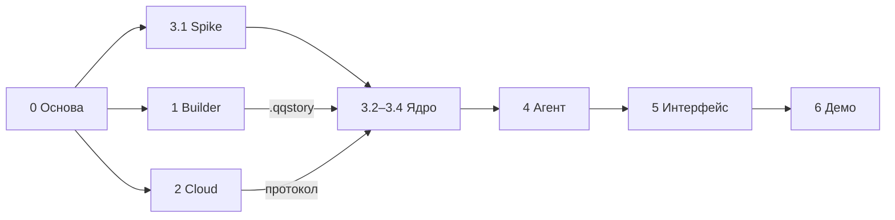

# Дорожная карта: реструктуризация QuipQuill

Прототип за 5 дней на основе старого Python-прототипа (ветка `main`). Новая работа идёт в ветке `project-131027`.

**Этап** — объём работы на один запрос к Claude Code: одна понятная цель, проверяемый результат, закрытие за одну сессию.
**Фаза** — группа этапов с общей целью.

## Как запускать этап

Напишите Claude Code: «Выполни этап X.Y из `docs/plan/roadmap.md`». В рамках этапа Claude:

1. читает [CLAUDE.md](../../CLAUDE.md) и документы из строки «Читать» этапа;
2. делает только то, что входит в этап; всё замеченное за рамками этапа записывает в [backlog.md](backlog.md);
3. проверяет результат по пункту «Готово, когда» (тесты, линтер, запуск);
4. ставит статус в таблице ниже и дописывает в документацию решения, которые изменились.

Статусы: `—` не начат · `▶` в работе · `✅` готов · `⏸` отложен.

## Обзор

| Этап | Название | Статус | День |
|---|---|---|---|
| **0** | **Основа репозитория** | | |
| 0.1 | Каркас монорепозитория | ✅ | 1 |
| 0.2 | Инфраструктура разработки | ✅ | 1 |
| **1** | **Builder (Python): граф истории → `.qqstory`** | | |
| 1.1 | Перенос экстрактора из `main` | ✅ | 1 |
| 1.2 | Экспорт в SQLite + эмбеддинги | ✅ | 1 |
| 1.3 | Демо-история | ✅ | 2 |
| **2** | **Cloud (FastAPI): авторизация, очередь, шлюз LLM** | | |
| 2.1 | Postgres и авторизация | ✅ | 1 |
| 2.2 | Очередь RabbitMQ и WebSocket | ✅ | 2 |
| 2.3 | LLM-воркер и эмбеддинги через OpenRouter | ✅ | 2 |
| 2.4 | Укрепление и Docker-образ | ✅ | 2 |
| **3** | **Mobile: основа ядра** | | |
| 3.1 | Проверки (spike) и точка решения | ✅ | 2 |
| 3.2 | Слой БД, импорт истории, сохранения | ✅ | 2 |
| 3.3 | Репозиторий мира и журнал событий | ✅ | 3 |
| 3.4 | Сеть: авторизация, WS-клиент, QueueChatModel | ✅ | 3 |
| **4** | **Агент мастера** | | |
| 4.1 | Мастер: промпт и инструменты | ✅ | 3 |
| 4.2 | Middleware: Guard, BugGuard, контекст | ✅ | 3 |
| 4.3 | `npc_react` и чаты NPC | ✅ | 4 |
| 4.4 | Старт сессии и адаптация персонажа | ✅ | 4 |
| **5** | **Интерфейс** | | |
| 5.1 | Каркас приложения и экраны | ✅ | 4 |
| 5.2 | Игровой экран со стримингом | ✅ | 4 |
| 5.3 | Сохранения и восстановление | ✅ | 5 |
| **6** | **Стабилизация и демо** | | |
| 6.1 | Сквозной прогон на устройстве, стоимость хода | ✅ | 5 |
| 6.2a | Динамический граф: слой изменений и связь CANCEL | ✅ | 6 |
| 6.2b | Векторы динамического графа | ✅ | 6 |
| 6.2c | Перемещение NPC и связи: инструменты мастера | ✅ | 6 |
| 6.2d | Фоновый генератор | ✅ | 6 |
| 6.2e | Восстановление стрима после ухода в фон | ▶ | 7 |
| 6.2f | Общие инструменты мира: set_entity, set_relation, игрок `player` | ✅ | 7 |
| 6.2g | Актёры: react_entity, внутренний голос, записки | — | 7 |
| 6.2h | Пакеты мастера: actor и запись решений | — | 7 |
| 6.2i | Генератор как afterAgent middleware | — | 7 |
| 6.2 | Настройка промптов по сценариям | — | 7 |
| 6.3 | Сборки и деплой | ▶ | 5 |
| **7+** | **После прототипа (MVP)** | см. [backlog.md](backlog.md) | |

### Параллельные дорожки

Фазы 1 и 2 и тесты ядра мобильного приложения (3.2–4.4) работают в Node и Docker, iOS-симулятор для них не нужен. Устройство или симулятор требуются только для 3.1, 5.x и 6.x, поэтому задержка с Xcode не блокирует работу.

---

## Фаза 0. Основа репозитория

### 0.1 Каркас монорепозитория
- **Цель:** структура папок и правила, на которые опираются все следующие этапы.
- **Читать:** [CLAUDE.md](../../CLAUDE.md), [architecture/overview.md](../architecture/overview.md).
- **Сделать:**
  - **Удалить вложенный репозиторий `apps/mobile/.git`.** Его создал `create-expo-app`, внутри только коммит шаблона `bda93cc Initial commit`. Иначе корневой git добавит `apps/mobile` как ссылку на вложенный репозиторий (gitlink), и файлы приложения не попадут в коммиты. Удалять только после подтверждения владельца.
  - Исправить корневой `.gitignore`: правило `.*` сейчас игнорирует **все** дотфайлы (`apps/mobile/.gitignore`, `.env.example`, `.vscode/`, `.claude/`). Заменить на явный список (`.env`, `.DS_Store`, `.venv/`, `__pycache__/`, `/logs` и т.п.).
  - Создать папки `cloud/`, `builder/`, `stories/`, `schema/` (общая SQL-схема `.qqstory`), `apps/mobile/src/core/` (ядро без импортов React Native).
  - Шаблон Expo: убрать демо-экраны (`npm run reset-project` или вручную), переименовать приложение: `name`, `slug`, `scheme` = `quipquill`, `ios.bundleIdentifier` / `android.package` = `app.quipquill.mobile` (уточнить домен у владельца).
  - Корневой `README.md` про новый проект; `.editorconfig`; `.env.example` для cloud и builder.
  - `.vscode/extensions.json` с рекомендованными расширениями (см. [dev-setup](../notes/dev-setup.md)).
- **Готово, когда:** `npx tsc --noEmit` и `npx expo lint` в `apps/mobile` проходят; `git status -uall` из корня показывает файлы `apps/mobile/*` по отдельности и нужные дотфайлы; дерево папок совпадает с [overview](../architecture/overview.md#структура-репозитория).

### 0.2 Инфраструктура разработки
- **Цель:** бэкенд поднимается одной командой.
- **Читать:** [architecture/overview.md](../architecture/overview.md), [architecture/protocol.md](../architecture/protocol.md).
- **Сделать:**
  - `docker-compose.yml` в корне: PostgreSQL 17, RabbitMQ 4 с management UI, тома, healthcheck.
  - `cloud/`: проект `uv` (Python 3.13), FastAPI, `pydantic-settings`, `/health`, ruff + pytest, структура пакетов (`api/`, `core/`, `mq/`, `llm/`, `db/`).
  - `Makefile` в корне: `infra-up`, `infra-down`, `cloud-dev`, `cloud-test`, `cloud-lint`.
- **Готово, когда:** `docker compose up -d` поднимает оба сервиса со статусом healthy; `uv run fastapi dev` отдаёт `/health` = 200; `uv run pytest` и `uv run ruff check` зелёные.

---

## Фаза 1. Builder (Python): граф истории → `.qqstory`

### 1.1 Перенос экстрактора из `main`
- **Цель:** экстрактор графа работает без Neo4j и Chroma.
- **Читать:** [notes/legacy-prototype.md](../notes/legacy-prototype.md).
- **Сделать:**
  - `builder/` как проект `uv`. Перенести `src/storymind/extractor.py`, `my_dataclasses.py`, нужные утилиты из `scripts/utils.py` и промпты извлечения из `config.yaml` (`git show 5a25926:<путь>`).
  - Убрать зависимости от Neo4j, Chroma, torch, LightRAG. LLM — OpenRouter через OpenAI-совместимый клиент; модель задаётся в конфиге.
  - CLI: `uv run builder extract <папка_с_лором> -o graph.json`.
- **Готово, когда:** на небольшом тексте (фикстура в `builder/tests/fixtures/`) получается JSON с сущностями и связями, включая `LEADS_TO`; pytest проходит, сеть в тестах замокана.

### 1.2 Экспорт в SQLite + эмбеддинги
- **Цель:** файл `.qqstory`, который мобильное приложение импортирует без преобразований.
- **Читать:** [architecture/data-model.md](../architecture/data-model.md).
- **Сделать:**
  - `schema/story.sql` — единственный источник схемы (Python и TS читают одну и ту же версию).
  - `uv run builder export graph.json -o story.qqstory`: стабильные ID (`loc:`, `item:`, `npc:`…), эмбеддинги имени и описания через OpenRouter (батчами) в виде float32 BLOB, заполнение `meta`.
  - Валидация: стартовая локация существует; граф `LEADS_TO` связный; нет висячих связей; задано `embed_model`.
  - Команда `uv run builder meta story.qqstory`: генерирует черновик `world_summary`, `world_constraints`, `style` одним вызовом LLM, с возможностью ручной правки.
- **Готово, когда:** тесты на фикстуре проходят; файл открывается в SQLite Viewer; валидатор ловит заведомо битый граф.

### 1.3 Демо-история
- **Цель:** одна хорошая история для демо на английском.
- **Сделать:** лор на 3–6 тыс. слов (8–15 локаций, 5–10 NPC, предметы, 1–2 загадки), прогон пайплайна, ручная правка графа, `meta` (стиль, ограничения мира, стартовая локация). Результат — `stories/brass-vault/` (лор, `graph.json`, `curation.toml`, `brass-vault.qqstory`).
- **Готово, когда:** валидатор зелёный; ручная проверка: из стартовой локации проходимы все ключевые места; у ключевых NPC есть описания, пригодные для персоны.

---

## Фаза 2. Cloud (FastAPI): авторизация, очередь, шлюз LLM

### 2.1 Postgres и авторизация
- **Читать:** [architecture/data-model.md](../architecture/data-model.md#postgresql-cloud).
- **Сделать:** SQLAlchemy 2 (async) + Alembic; таблицы `users`, `refresh_tokens`, `usage_events`; регистрация и вход по email и паролю (argon2), JWT access (15 мин) + refresh (30 дней, ротация); `/auth/register`, `/auth/login`, `/auth/refresh`, `/me`; поле `tier` (`free | pro | max`, в прототипе у всех `free` → Haiku).
- **Готово, когда:** pytest на регистрацию, вход, refresh и отозванный токен проходит против тестового Postgres из compose.

### 2.2 Очередь RabbitMQ и WebSocket
- **Читать:** [architecture/protocol.md](../architecture/protocol.md), [notes/ai-samba-ideas.md](../notes/ai-samba-ideas.md).
- **Сделать:** `aio-pika`; очереди `qq.commands` и `qq.events` (durable, префикс окружения); `WS /ws?token=`; конверты сообщений на Pydantic; диспетчер событий по `sessionId`; буфер активной генерации + `resume`; heartbeat; политика ошибок (ack при ошибке, `reject(requeue=False)` для битого JSON); эхо-воркер для проверки.
- **Готово, когда:** интеграционный тест: клиент отправляет `llm.request`, получает `status → delta… → done`; после переподключения посреди генерации `resume` отдаёт `replay`.

### 2.3 LLM-воркер и эмбеддинги через OpenRouter
- **Сделать:**
  - Воркер: команда → стриминговый chat completions OpenRouter (с инструментами) → события `delta`, `tool_call`, `done` (собранное сообщение + `usage`).
  - Модель, `max_tokens` и `effort` выбирает **сервер** по `tier` и `purpose`, а не клиент.
  - Провайдеры для игровых вызовов — только `amazon-bedrock` и `google-vertex/global`, `allow_fallbacks: false` (ADR 16).
  - Перед запросом — проверка лимитов, после — запись в `usage_events`; таймауты; `cancel`.
  - `POST /embeddings` (батч).
  - **Проверить**, проходит ли кэширование промпта через OpenRouter (`cache_read` в usage) и как передаются effort и thinking для Haiku 5.5; итог записать в [notes/research.md](../notes/research.md).
- **Готово, когда:** живой тест с ключом OpenRouter (маркер `integration`): ответ стримится, вызов инструмента собирается целиком, usage записан, лимит срабатывает.

### 2.4 Укрепление и Docker-образ
- **Сделать:** Dockerfile для cloud, сервис в compose; ограничения размера запроса и частоты на пользователя; структурные логи с `requestId`; `/health/db`, `/health/mq`, `/health/llm`; `.env.example` актуален.
- **Готово, когда:** `docker compose up` поднимает весь бэкенд; health-эндпоинты отражают падение каждой зависимости.

---

## Фаза 3. Mobile: основа ядра

### 3.1 Проверки (spike) и точка решения
- **Цель:** до основной работы снять два главных технических риска.
- **Сделать** (dev-сборка на iOS-симуляторе или Android-эмуляторе):
  1. op-sqlite с включённым sqlite-vec (ключ конфигурации — по README op-sqlite): создать `vec0`, вставить и найти вектор. Если не работает — проверить поиск перебором в JS на 5 тыс. векторов и замерить время.
  2. LangChain JS v1 `createAgent` + `dynamicSystemPromptMiddleware` + свой `beforeAgent` на Hermes с фейковой чат-моделью и одним инструментом.
- **Итог:** запись в [notes/spikes.md](../notes/spikes.md) и решение в [architecture/decisions.md](../architecture/decisions.md): **LangChain JS** или **свой цикл агента** (~150 строк с теми же хуками); **sqlite-vec** или **перебор в JS**.
- **Готово, когда:** решения записаны, проверочный код удалён или вынесен в `apps/mobile/spikes/`.

### 3.2 Слой БД, импорт истории, сохранения
- **Сделать:**
  - `src/core/storage/`: интерфейс `Db` (порт) + адаптер op-sqlite (в приложении) + адаптер better-sqlite3 (для тестов в Node).
  - Порт `VectorIndex`: адаптер sqlite-vec (`vec0` из BLOB при импорте) в приложении, перебор в JS — в тестах и как запасной ([ADR 26](../architecture/decisions.md#26-векторный-поиск-sqlite-vec-за-портом-перебор-в-js-запасной)).
  - Тестовый раннер для ядра (vitest или jest — выбрать по совместимости с Expo SDK 57).
  - `app.db` (персонажи, список историй и сохранений).
  - Импорт `.qqstory` через `expo-document-picker`: копирование в документы, проверка `schema_version`, построение векторного индекса.
  - Сохранение = копия файла истории + таблицы состояния.
  - Builder: стабильный `story_id` и authored meta из `stories/<id>/meta.toml` ([ADR 24](../architecture/decisions.md#24-стабильный-story_id-и-authored-meta-в-storiesidmetatoml)); импорт узнаёт новую версию той же истории по `story_id`.
- **Готово, когда:** тесты ядра в Node проходят на фикстуре из builder; в приложении импорт демо-истории показывает её название.

### 3.3 Репозиторий мира и журнал событий
- **Читать:** [architecture/data-model.md](../architecture/data-model.md#события).
- **Сделать:**
  - Запросы: текущая локация, выходы, что здесь лежит, инвентарь, сущность по ID или имени (нечёткий поиск), векторный поиск.
  - Применение событий в одной транзакции: событие + обновление `state_*`.
  - Последние N событий; заметки мастера.
- **Готово, когда:** юнит-тесты на каждое событие и на запреты (переход в несоседнюю локацию, взять предмет из другой локации).

### 3.4 Сеть: авторизация, WS-клиент, QueueChatModel
- **Сделать:**
  - Хранение токенов в `expo-secure-store`, обновление токена.
  - ~~`globalThis.crypto` из `expo-crypto`~~ — сделано в 3.2 (`src/platform/polyfills.ts`, ADR 27).
  - Авторизация WebSocket первым сообщением `auth` вместо `?token=` — облако, протокол и клиент ([ADR 22](../architecture/decisions.md#22-авторизация-websocket-первым-сообщением)).
  - WS-клиент: переподключение с backoff, `resume`, heartbeat, типизированный протокол.
  - `QueueChatModel`: запрос → дельты в UI → `done.message` как итог с tool_calls.
  - Клиент эмбеддингов.
- **Готово, когда:** тест ядра против локального cloud (эхо- или живой воркер) проходит; разрыв сети посреди ответа восстанавливается через replay.

---

## Фаза 4. Агент мастера

Архитектура: [architecture/agent.md](../architecture/agent.md).

### 4.1 Мастер: промпт и инструменты
- **Сделать:**
  - Системный промпт мастера на английском (на основе legacy `system_lite`, без перечисления инструментов в тексте). Маркеры `{{STORY_STYLE}}` и `{{WORLD_STATE}}`; стабильный префикс для кэша.
  - Инструменты: `move` (с проверкой `LEADS_TO`), `inspect`, `take`, `drop`, `search_lore`, `add_entity`, `edit_entity`, `update_player`, `note`. Ошибки возвращаются текстом.
  - Функция `runTurn()` и тестовый стенд с фейковой моделью, работающей по сценарию.
  - Агент на `createAgent` из LangChain JS ([ADR 25](../architecture/decisions.md#25-агент-мастера-на-langchain-js-v1-с-обходами-для-hermes)): перенести обходы для Hermes из `apps/mobile/spikes/shims` в `src/platform/` (импорт до ядра), закрепить версии `langchain` / `@langchain/*`; шаблон — `apps/mobile/spikes/agent.ts`.
  - **Первым делом** — обходы LangChain для Hermes в продакшн-код: `async-hooks` → `src/platform/shims/` (путь в `metro.config.js`), `navigator.userAgent` и `AbortSignal.prototype.throwIfAborted` → `src/platform/polyfills.ts` (крипто там уже есть); проверить запуск агента на симуляторе. Версии `langchain`, `@langchain/core`, `@langchain/langgraph`, `langsmith` — точные (без `^`), обновление — только вместе с повторным прогоном на Hermes.
  - Битые аргументы инструментов: `QueueChatModel` кладёт их в `invalid_tool_calls`, `createAgent` их не исполняет — вернуть модели ошибку текстом (как ответ инструмента), а не заканчивать ход молча.
  - `take` у NPC рядом — только обыгранно, с конкретным предметом ([ADR 32](../architecture/decisions.md#32-предмет-у-npc-можно-забрать--только-обыгранно)).
- **Готово, когда:** сценарные тесты: «осмотреться → пойти → взять → проверить инвентарь» дают правильные события и состояние.

### 4.2 Middleware: Guard, BugGuard, контекст
- **Сделать:**
  - **BugGuard:** убирает `tool_calls`, на которые не пришёл ответ.
  - **Guard** (`beforeAgent`): дешёвый вызов со структурированным ответом `pass|reject`; системные сообщения пропускаются.
  - **Управление контекстом:** порог (~30K токенов), сжатие с безопасной точкой разреза, при неудаче — обрезка, жёсткий потолок < 100K.
  - Разделение `model_messages` / `transcript`; лимит итераций инструментов за ход.
- **Готово, когда:** тесты на каждый middleware, включая обрыв посреди вызова инструмента и переполнение контекста.

### 4.3 `npc_react` и чаты NPC
- **Сделать:** инструмент `npc_react(target, situation)` ([ADR 33](../architecture/decisions.md#33-npc_react-вместо-ask)): промпт NPC (персона из сущности и соседей в графе; реакция словами и/или действием), отдельный чат в `model_messages(chat_id='npc:<id>')`, канал `npc:<id>` для стрима в UI, соглашение `[silence]`, возврат реакции мастеру, событие `npc.reacted`, правило «не повторять реплику NPC».
- **Готово, когда:** тесты «спросить трактирщика», «спросить камень» и «выхватить предмет у NPC» (реакция владельца, затем `take` при успехе); в UI-событиях реакция NPC приходит отдельным каналом.

### 4.4 Старт сессии и адаптация персонажа
- **Сделать:** системная команда `session_start`; инструмент `propose_character` (адаптированный персонаж + до 2 альтернатив + объяснение); выбор игрока или своё уточнение (до 3 кругов); событие `character.adapted`; вступительная сцена в `meta.start_location`.
- **Готово, когда:** сценарный тест полного старта: эльф в мире без эльфов получает адаптацию и альтернативы, после выбора начинается сцена.

---

## Фаза 5. Интерфейс

### 5.1 Каркас приложения и экраны
- **Сделать:** Expo Router; экраны «Вход», «Истории» (импорт и список), «Персонажи» (список + анкета: имя, пол, возраст, раса, описание), «Новая игра» (история + персонаж), «Игра»; тема светлая и тёмная.
- **Готово, когда:** на симуляторе можно войти, импортировать историю, создать персонажа и дойти до пустого игрового экрана.

### 5.2 Игровой экран со стримингом
- **Сделать:** пузыри мастера и NPC с подписью говорящего; стриминг дельт; статусы (`thinking`); карточки выбора для `propose_character`; поле ввода; блокировка ввода во время хода; ошибки и повтор; восстановление после ухода приложения в фон.
- **Готово, когда:** полный ход с NPC виден в реальном времени; сворачивание и разворачивание посреди ответа не теряет текст.

### 5.3 Сохранения и восстановление
- **Сделать:** список сохранений, «Продолжить», «Начать заново» (повторное копирование истории), удаление; восстановление `transcript` при открытии.
- **Готово, когда:** после перезапуска приложения партия продолжается с того же места.

---

## Фаза 6. Стабилизация и демо

### 6.1 Сквозной прогон на устройстве, стоимость хода
- **Сделать:** полный сценарий на симуляторе и реальном телефоне; исправление багов; отладочная панель со стоимостью хода (usage из `done`).
- **Готово, когда:** демо-сценарий проходит без ошибок 3 раза подряд; известна средняя стоимость хода.

### 6.2a Динамический граф: слой изменений и связь CANCEL
По итогам ручных проверок 6.2–6.3: [ADR 42](../architecture/decisions.md#42-динамический-граф-поверх-истории-слой-изменений-связь-cancel-генератор). Старые сохранения (`state_*`) не переносятся.
- **Читать:** [data-model](../architecture/data-model.md#сохранение-партии-savesiddb), ADR 4, 29, 42; `src/core/world/`, `src/core/library/save-schema.ts`.
- **Сделать:**
  - Новый шаг схемы сохранения: `dyn_entities`, `dyn_relations` (с `CANCEL`), представления `world_entities` / `world_relations`; `state_*` больше не создаются. Сохранения старой версии библиотека честно помечает как несовместимые (удалить или начать заново).
  - `session.started` больше не копирует историю: в `dyn_*` попадают только игрок и его размещение.
  - `WorldState` читает только `world_*`; команды мира пишут только `dyn_*`: замена сущности целиком, связь истории снимается через `CANCEL`, динамическая — удалением, запись связи снимает её `CANCEL`. Поведение всех существующих событий не меняется.
  - Перезапуск партии (`SaveManager.restart`) работает как раньше.
- **Готово, когда:** все прежние тесты мира, агента и игры зелёные на новой схеме; новые тесты: после партии `entities` / `relations` / `embeddings` байт в байт как в истории; `CANCEL` скрывает ровно одну связь; динамика перекрывает статику; `tsc`, линтер.

### 6.2b Векторы динамического графа
- **Читать:** ADR 26, 42; `src/core/vector/`, `src/core/net/embeddings.ts`.
- **Сделать:** `dyn_embeddings`; после коммита `entity.added` / `entity.edited` (и смены имени) — пересчёт векторов `name` / `desc` облачными эмбеддингами, вне транзакции; недосчитанные — при открытии партии. `searchLore`: индекс истории ∪ перебор `dyn_embeddings`, векторы истории переписанных сущностей отфильтровываются на выходе.
- **Готово, когда:** тест «переписать описание NPC → поиск по старому смыслу его не находит, по новому — находит»; без сети поиск работает, переписанная сущность не всплывает по старому тексту.

### 6.2c Перемещение NPC и связи: инструменты мастера
- **Читать:** [agent](../architecture/agent.md#инструменты-мастера), ADR 33, 42; `src/core/agent/tools.ts`, `src/core/agent/npc.ts`.
- **Сделать:** команды мира и события `npc.moved` (в любую `LOCATION`), `relation.set`, `relation.cancelled`; инструменты мастера `move_npc`, `set_relation`, `cancel_relation` (ошибки — текстом); промпт NPC собирает связи из `world_relations`; правило в промпте мастера — отражать решения игрока в связях и описаниях NPC; [agent.md](../architecture/agent.md) и data-model — по факту.
- **Готово, когда:** сценарные тесты: «NPC уходит в другую локацию и находится там»; «игрок отказался от заговора → мастер отменяет связь → в промпте NPC её больше нет».

### 6.2d Фоновый генератор
- **Читать:** [protocol](../architecture/protocol.md) (`purpose`), [agent](../architecture/agent.md), ADR 37, 38, 42; legacy `updator_system_prompt` (`git show 5a25926:src/storymind/prompts.py`).
- **Сделать:**
  - Облако: `purpose: generator` в политике LLM (модель, `max_tokens`, effort — по тарифу).
  - Ядро: после хода мастера — один вызов со структурированным ответом (промпт на английском, стабильная часть в начале): сцена, события и текст хода, связи затронутых NPC → список изменений (описание, связь, отмена связи, перемещение NPC, новая сущность). Применяются командами мира с `actor = 'generator'`; ошибки команд — в журнал разработчика, не игроку.
  - Игрок ответ не ждёт; следующий ход ждёт генератор под замком хода (явный таймаут, по таймауту — отмена). Стоимость генератора видна в dev-строке стоимости (ADR 38).
- **Готово, когда:** тест с моделью по сценарию (изменения применяются, неверные — отбрасываются без падения); живой прогон «отказ от заговора» на Haiku — NPC в следующих ходах ведут себя по-новому; известна новая средняя стоимость хода.

### 6.2e Восстановление стрима после ухода в фон
По итогам ручных проверок после 6.2d ([ADR 43](../architecture/decisions.md#43-актёры-вместо-чатов-npc-пакеты-мастера-общие-инструменты-мира)): задать вопрос, свернуть приложение на пару минут — после возврата стрим не продолжается, чат зависает.
- **Читать:** [protocol](../architecture/protocol.md#буфер-активной-генерации-и-resume), ADR 30; `src/core/net/cloud-socket.ts`, `src/core/net/queue-chat-model.ts`, `src/hooks/use-game.ts`, `src/core/game/game.ts`.
- **Сделать:**
  - Сначала поиск по симптомам (React Native / iOS: WebSocket и таймеры в фоне), затем гипотезы с проверкой от дешёвых: (а) таймаут запроса 90 с (ADR 30) срабатывает при возврате из фона — запрос завершается `timeout` и не повторяется, хотя сервер держит ответ 15 мин; (б) сокет после фона не переподключается или не шлёт `resume`, пока не истечёт проверка ping (25 с); (в) интерфейс не выходит из «занят» после ошибки или потерянного `done`; (г) iOS / Android закрывают сокет без события `close`.
  - Воспроизвести в Node-тесте (сокет рвётся посреди генерации, время «перепрыгивает» на 2+ мин, `done` приходит после `resume`), исправить причину; при возврате приложения из фона — явное переподключение и `resume` (событие `AppState` в платформенном слое).
  - Если ответ уже потерян — понятное состояние: «Продолжить» (`recover`), а не вечное ожидание.
- **Готово, когда:** тест «свернули на 2+ мин посреди ответа → ответ дошёл или предложено продолжить»; ручная проверка на iOS-симуляторе и Android-эмуляторе по сценарию из [run-guide](../notes/run-guide.md).

### 6.2f Общие инструменты мира: set_entity, set_relation, игрок `player`
- **Читать:** ADR 19, 29, 31, 32, 34, 42, 43; [agent](../architecture/agent.md#инструменты-мастера), [data-model](../architecture/data-model.md); `src/core/world/`, `src/core/agent/tools.ts`, `src/core/agent/prompt.ts`.
- **Сделать:**
  - Команды мира `setEntity` (переданные поля существующей сущности; новая — все поля, кроме мест) и `setRelation` (обновить или создать): для `LOCATED_IN` / `HAS_ITEM` — прежние правила (игрок только по `LEADS_TO` и в места внутри места; `fixed` не взять; предмет у NPC — после его реакции в этом ходу; одно место у сущности, старое снимается само), для связей-отношений — как 6.2c. `cancelRelation` — как 6.2c. События — прежних видов (`player.moved`, `item.taken`, `item.dropped`, `npc.moved`, `relation.set`, `entity.added`, `entity.edited`).
  - Игрок — сущность `player` в динамическом графе в стартовой локации; правки игрока — `set_entity` с id `player` (событие `entity.edited`; `player.updated` уходит).
  - Инструменты мастера: `set_entity`, `set_relation`, `cancel_relation` (в описании — применять после `set_relation`, когда старая связь стала неправдой), `inspect`, `search_lore`, `note`; `move`, `take`, `drop`, `move_npc`, `add_entity`, `edit_entity`, `update_player` убрать. Промпт мастера — под новые инструменты. Генератор (6.2d) применяет изменения теми же командами.
  - Сохранения со старым id игрока не открываются (`SaveOutdatedError`, «начать заново»).
- **Готово, когда:** сценарные тесты прежних правил через новые инструменты (пойти не по выходу, взять `fixed`, выхватить у NPC без реакции — ошибка текстом; взять, положить, уйти — правильные события); «NPC сказал про мешок → мастер создал мешок → игрок его взял»; демо-сценарий 6.1 со сценарной моделью; `tsc`, линтер.

### 6.2g Актёры: react_entity, внутренний голос, записки
- **Читать:** ADR 33, 34, 43; [agent](../architecture/agent.md#npc_react--реакция-npc); `src/core/agent/npc.ts`, `src/core/world/event-log.ts`.
- **Сделать:**
  - `react_entity(target, situation)` вместо `npc_react`: любая сущность рядом (или в инвентаре). Актёр — короткий вызов (`purpose: npc`) с промптом на английском: кто ты (описание, связи, твои записки), что видишь, что произошло → ответ мастеру: эмоция и желание (внутренний голос), не реплика игроку; неживое без реакции — `[silence]`. Событие `entity.reacted` (было `npc.reacted`; правило ADR 34 — по нему).
  - Записки актёра: таблица `notes` получает `entity_id` (или своя таблица — решить в этапе); записки сущности — в её промпте актёра; отдельные чаты NPC (`model_messages` `npc:*`) больше не пишутся.
- **Готово, когда:** тесты: реакция NPC и «реакция» предмета (магическое зеркало), `[silence]` у камня, записки попадают в следующий промпт актёра, ADR 34 работает через `entity.reacted`.

### 6.2h Пакеты мастера: actor и запись решений
- **Читать:** ADR 25, 36, 43; [ai-samba-ideas](../notes/ai-samba-ideas.md) (паки — только идеи); `src/core/agent/gm-agent.ts`, `src/core/agent/middleware/`, `src/core/agent/run-turn.ts`.
- **Сделать:**
  - Middleware пакетов: после результата `react_entity` следующий вызов модели — в пакете **actor** (промпт: сыграть сущность по её внутреннему голосу, без инструментов; реплика в канал `npc:<id>`, в `transcript` — от имени сущности, отдельным пузырём); затем пакет мастера с добавкой: динамический инструмент `actor_note` (id — из последнего `react_entity`) и указание кратко записать решения сущности; затем ответ игроку. Новый ход — стандартный пакет. Добавка — наследование стандартного пакета.
  - Правило достоверности в пакете мастера: факт о мире, который сущность сказала честно (дверь, мешок), мастер делает реальным `set_entity` / `set_relation`; ложь видна из внутреннего голоса.
  - Стоимость и время реакции — замер (сравнить с 6.1 / 6.2d).
- **Готово, когда:** сценарные тесты полного цикла (react → actor → actor_note → ответ), повтор оборванного хода посреди цикла, сценарий «дверь в переулке» (сказанное честным NPC существует в мире); живой прогон на Haiku с замером стоимости.

### 6.2i Генератор как afterAgent middleware
- **Читать:** ADR 42, 43; `src/core/agent/generator.ts`, `src/core/game/game.ts`.
- **Сделать:** запуск генератора — `afterAgent` middleware агента мастера (в фоне, без ожидания игроком); замок хода, ожидание следующим действием, таймаут и отмена — как в 6.2d; промпт генератора — под новые инструменты и записки актёров.
- **Готово, когда:** тесты 6.2d проходят на новом месте запуска; живой прогон «отказ от ограбления».

### 6.2 Настройка промптов по сценариям
- **Сделать:** `docs/notes/golden-scenarios.md` — 10–15 ручных сценариев (несоседняя локация, несуществующий предмет, попытка обмана, «спросить камень», адаптация персонажа, длинная сессия), прогон и правка промптов по одному блоку за раз.
- **Готово, когда:** все сценарии в чек-листе отмечены как пройденные.

### 6.3 Сборки и деплой
- **Сделать:** иконка, сплэш, название; `eas.json` (development / preview); сборка TestFlight или Ad Hoc для iOS и APK для Android; деплой cloud на VPS (docker compose + Caddy для TLS) — ✅ вместе с CI/CD, см. [deploy](../notes/deploy.md); `docs/notes/demo-script.md` — сценарий показа инвестору.
- **Готово, когда:** партнёр ставит приложение на свой телефон и проходит демо против облака.
