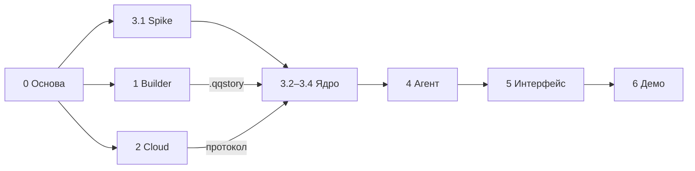

# Дорожная карта: реструктуризация QuipQuill

Прототип за 5 дней на основе старого Python-прототипа (ветка `main`). Новая работа идёт в ветке `project-131027`.

**Этап** — объём работы на один запрос к Claude Code: одна понятная цель, проверяемый результат, закрытие за одну сессию.
**Фаза** — группа этапов с общей целью.

## Как запускать этап

Напишите Claude Code: «Выполни этап X.Y из `docs/plan/roadmap.md`». В рамках этапа Claude:

1. читает [CLAUDE.md](../../CLAUDE.md) и документы из строки «Читать» этапа;
2. делает только то, что входит в этап; всё замеченное за рамками этапа записывает в [backlog.md](backlog.md);
3. проверяет результат по пункту «Готово, когда» (тесты, линтер, запуск);
4. ставит статус в таблице ниже и дописывает в документацию решения, которые изменились.

Статусы: `—` не начат · `▶` в работе · `✅` готов · `⏸` отложен.

## Обзор

| Этап | Название | Статус | День |
|---|---|---|---|
| **0** | **Основа репозитория** | | |
| 0.1 | Каркас монорепозитория | ✅ | 1 |
| 0.2 | Инфраструктура разработки | ✅ | 1 |
| **1** | **Builder (Python): граф истории → `.qqstory`** | | |
| 1.1 | Перенос экстрактора из `main` | ✅ | 1 |
| 1.2 | Экспорт в SQLite + эмбеддинги | ✅ | 1 |
| 1.3 | Демо-история | ✅ | 2 |
| **2** | **Cloud (FastAPI): авторизация, очередь, шлюз LLM** | | |
| 2.1 | Postgres и авторизация | ✅ | 1 |
| 2.2 | Очередь RabbitMQ и WebSocket | ✅ | 2 |
| 2.3 | LLM-воркер и эмбеддинги через OpenRouter | ✅ | 2 |
| 2.4 | Укрепление и Docker-образ | ✅ | 2 |
| **3** | **Mobile: основа ядра** | | |
| 3.1 | Проверки (spike) и точка решения | ✅ | 2 |
| 3.2 | Слой БД, импорт истории, сохранения | ✅ | 2 |
| 3.3 | Репозиторий мира и журнал событий | ✅ | 3 |
| 3.4 | Сеть: авторизация, WS-клиент, QueueChatModel | ✅ | 3 |
| **4** | **Агент мастера** | | |
| 4.1 | Мастер: промпт и инструменты | ✅ | 3 |
| 4.2 | Middleware: Guard, BugGuard, контекст | ✅ | 3 |
| 4.3 | `npc_react` и чаты NPC | ✅ | 4 |
| 4.4 | Старт сессии и адаптация персонажа | ✅ | 4 |
| **5** | **Интерфейс** | | |
| 5.1 | Каркас приложения и экраны | ✅ | 4 |
| 5.2 | Игровой экран со стримингом | ✅ | 4 |
| 5.3 | Сохранения и восстановление | ✅ | 5 |
| **6** | **Стабилизация и демо** | | |
| 6.1 | Сквозной прогон на устройстве, стоимость хода | ✅ | 5 |
| 6.2a | Динамический граф: слой изменений и связь CANCEL | ✅ | 6 |
| 6.2b | Векторы динамического графа | ✅ | 6 |
| 6.2c | Перемещение NPC и связи: инструменты мастера | ✅ | 6 |
| 6.2d | Фоновый генератор | ✅ | 6 |
| 6.2e | Восстановление стрима после ухода в фон | ▶ | 7 |
| 6.2f | Общие инструменты мира: set_entity, set_relation, игрок `player` | ✅ | 7 |
| 6.2g | Актёры: react_entity, внутренний голос, записки | ✅ | 7 |
| 6.2h | Пакеты мастера: actor и запись решений | ✅ | 7 |
| 6.2h2 | Дешёвые актёры: реплика из чата сущности, note_entity в фоне | ✅ | 7 |
| 6.2h3 | Кэш истории мастера | ✅ | 7 |
| 6.2i | Генератор как afterAgent middleware | ✅ | 7 |
| 6.2j | Удача: roll_luck, находки и логичные упущения | ✅ | 7 |
| 6.2k | Черновики Guard и восстановление фона | ✅ | 7 |
| 6.2 | Настройка промптов по сценариям | ▶ | 7 |
| 6.3 | Сборки и деплой | ▶ | 5 |
| **R** | **Рефакторинг** | | |
| R.1 | Структурированные вызовы LLM: общий помощник | ✅ | 8 |
| R.2 | Словарь модели мира: типы сущностей, связей, акторов | ✅ | 8 |
| R.3 | Сообщения хода и каналы | ✅ | 8 |
| R.4 | Чистка `World` | ✅ | 8 |
| R.5 | Связь react_entity → актёр, учёт стоимости в `Game` | ✅ | 8 |
| R.6 | Cloud и builder: маршрутизация событий, сервисы, обработчик LLM | ✅ | 8 |
| **D** | **Дизайн, онбординг, истории из облака** | | |
| D.1 | Дизайн-система: токены, шрифты, компоненты | ✅ | 9 |
| D.2 | Иконка и сплэш | ✅ | 9 |
| D.3 | Анимация загрузки «Бубенцы» | ✅ | 10 |
| D.4 | Облако: каталог историй, гость, согласие | ▶ | 9 |
| D.5 | Ядро и builder: скачивание историй, настройки, герои истории | ✅ | 10 |
| D.5a | Прототип без входа: гость, общий лимит, список желающих | ✅ | 11 |
| D.6 | Онбординг | ✅ | 11 |
| D.7 | Основной интерфейс: вкладки, страница истории, игровой экран | ✅ | 11 |
| D.8 | Прогон на устройстве и документы | — | 11 |
| **7+** | **После прототипа (MVP)** | см. [backlog.md](backlog.md) | |

### Параллельные дорожки

Фазы 1 и 2 и тесты ядра мобильного приложения (3.2–4.4) работают в Node и Docker, iOS-симулятор для них не нужен. Устройство или симулятор требуются только для 3.1, 5.x и 6.x, поэтому задержка с Xcode не блокирует работу.



---

## Фаза 0. Основа репозитория

### 0.1 Каркас монорепозитория
- **Цель:** структура папок и правила, на которые опираются все следующие этапы.
- **Читать:** [CLAUDE.md](../../CLAUDE.md), [architecture/overview.md](../architecture/overview.md).
- **Сделать:**
  - **Удалить вложенный репозиторий `apps/mobile/.git`.** Его создал `create-expo-app`, внутри только коммит шаблона `bda93cc Initial commit`. Иначе корневой git добавит `apps/mobile` как ссылку на вложенный репозиторий (gitlink), и файлы приложения не попадут в коммиты. Удалять только после подтверждения владельца.
  - Исправить корневой `.gitignore`: правило `.*` сейчас игнорирует **все** дотфайлы (`apps/mobile/.gitignore`, `.env.example`, `.vscode/`, `.claude/`). Заменить на явный список (`.env`, `.DS_Store`, `.venv/`, `__pycache__/`, `/logs` и т.п.).
  - Создать папки `cloud/`, `builder/`, `stories/`, `schema/` (общая SQL-схема `.qqstory`), `apps/mobile/src/core/` (ядро без импортов React Native).
  - Шаблон Expo: убрать демо-экраны (`npm run reset-project` или вручную), переименовать приложение: `name`, `slug`, `scheme` = `quipquill`, `ios.bundleIdentifier` / `android.package` = `app.quipquill.mobile` (уточнить домен у владельца).
  - Корневой `README.md` про новый проект; `.editorconfig`; `.env.example` для cloud и builder.
  - `.vscode/extensions.json` с рекомендованными расширениями (см. [dev-setup](../notes/dev-setup.md)).
- **Готово, когда:** `npx tsc --noEmit` и `npx expo lint` в `apps/mobile` проходят; `git status -uall` из корня показывает файлы `apps/mobile/*` по отдельности и нужные дотфайлы; дерево папок совпадает с [overview](../architecture/overview.md#структура-репозитория).

### 0.2 Инфраструктура разработки
- **Цель:** бэкенд поднимается одной командой.
- **Читать:** [architecture/overview.md](../architecture/overview.md), [architecture/protocol.md](../architecture/protocol.md).
- **Сделать:**
  - `docker-compose.yml` в корне: PostgreSQL 17, RabbitMQ 4 с management UI, тома, healthcheck.
  - `cloud/`: проект `uv` (Python 3.13), FastAPI, `pydantic-settings`, `/health`, ruff + pytest, структура пакетов (`api/`, `core/`, `mq/`, `llm/`, `db/`).
  - `Makefile` в корне: `infra-up`, `infra-down`, `cloud-dev`, `cloud-test`, `cloud-lint`.
- **Готово, когда:** `docker compose up -d` поднимает оба сервиса со статусом healthy; `uv run fastapi dev` отдаёт `/health` = 200; `uv run pytest` и `uv run ruff check` зелёные.

---

## Фаза 1. Builder (Python): граф истории → `.qqstory`

### 1.1 Перенос экстрактора из `main`
- **Цель:** экстрактор графа работает без Neo4j и Chroma.
- **Читать:** [notes/legacy-prototype.md](../notes/legacy-prototype.md).
- **Сделать:**
  - `builder/` как проект `uv`. Перенести `src/storymind/extractor.py`, `my_dataclasses.py`, нужные утилиты из `scripts/utils.py` и промпты извлечения из `config.yaml` (`git show 5a25926:<путь>`).
  - Убрать зависимости от Neo4j, Chroma, torch, LightRAG. LLM — OpenRouter через OpenAI-совместимый клиент; модель задаётся в конфиге.
  - CLI: `uv run builder extract <папка_с_лором> -o graph.json`.
- **Готово, когда:** на небольшом тексте (фикстура в `builder/tests/fixtures/`) получается JSON с сущностями и связями, включая `LEADS_TO`; pytest проходит, сеть в тестах замокана.

### 1.2 Экспорт в SQLite + эмбеддинги
- **Цель:** файл `.qqstory`, который мобильное приложение импортирует без преобразований.
- **Читать:** [architecture/data-model.md](../architecture/data-model.md).
- **Сделать:**
  - `schema/story.sql` — единственный источник схемы (Python и TS читают одну и ту же версию).
  - `uv run builder export graph.json -o story.qqstory`: стабильные ID (`loc:`, `item:`, `npc:`…), эмбеддинги имени и описания через OpenRouter (батчами) в виде float32 BLOB, заполнение `meta`.
  - Валидация: стартовая локация существует; граф `LEADS_TO` связный; нет висячих связей; задано `embed_model`.
  - Команда `uv run builder meta story.qqstory`: генерирует черновик `world_summary`, `world_constraints`, `style` одним вызовом LLM, с возможностью ручной правки.
- **Готово, когда:** тесты на фикстуре проходят; файл открывается в SQLite Viewer; валидатор ловит заведомо битый граф.

### 1.3 Демо-история
- **Цель:** одна хорошая история для демо на английском.
- **Сделать:** лор на 3–6 тыс. слов (8–15 локаций, 5–10 NPC, предметы, 1–2 загадки), прогон пайплайна, ручная правка графа, `meta` (стиль, ограничения мира, стартовая локация). Результат — `stories/brass-vault/` (лор, `graph.json`, `curation.toml`, `brass-vault.qqstory`).
- **Готово, когда:** валидатор зелёный; ручная проверка: из стартовой локации проходимы все ключевые места; у ключевых NPC есть описания, пригодные для персоны.

---

## Фаза 2. Cloud (FastAPI): авторизация, очередь, шлюз LLM

### 2.1 Postgres и авторизация
- **Читать:** [architecture/data-model.md](../architecture/data-model.md#postgresql-cloud).
- **Сделать:** SQLAlchemy 2 (async) + Alembic; таблицы `users`, `refresh_tokens`, `usage_events`; регистрация и вход по email и паролю (argon2), JWT access (15 мин) + refresh (30 дней, ротация); `/auth/register`, `/auth/login`, `/auth/refresh`, `/me`; поле `tier` (`free | pro | max`, в прототипе у всех `free` → Haiku).
- **Готово, когда:** pytest на регистрацию, вход, refresh и отозванный токен проходит против тестового Postgres из compose.

### 2.2 Очередь RabbitMQ и WebSocket
- **Читать:** [architecture/protocol.md](../architecture/protocol.md), [notes/ai-samba-ideas.md](../notes/ai-samba-ideas.md).
- **Сделать:** `aio-pika`; очереди `qq.commands` и `qq.events` (durable, префикс окружения); `WS /ws?token=`; конверты сообщений на Pydantic; диспетчер событий по `sessionId`; буфер активной генерации + `resume`; heartbeat; политика ошибок (ack при ошибке, `reject(requeue=False)` для битого JSON); эхо-воркер для проверки.
- **Готово, когда:** интеграционный тест: клиент отправляет `llm.request`, получает `status → delta… → done`; после переподключения посреди генерации `resume` отдаёт `replay`.

### 2.3 LLM-воркер и эмбеддинги через OpenRouter
- **Сделать:**
  - Воркер: команда → стриминговый chat completions OpenRouter (с инструментами) → события `delta`, `tool_call`, `done` (собранное сообщение + `usage`).
  - Модель, `max_tokens` и `effort` выбирает **сервер** по `tier` и `purpose`, а не клиент.
  - Провайдеры для игровых вызовов — только `amazon-bedrock` и `google-vertex/global`, `allow_fallbacks: false` (ADR 16).
  - Перед запросом — проверка лимитов, после — запись в `usage_events`; таймауты; `cancel`.
  - `POST /embeddings` (батч).
  - **Проверить**, проходит ли кэширование промпта через OpenRouter (`cache_read` в usage) и как передаются effort и thinking для Haiku 5.5; итог записать в [notes/research.md](../notes/research.md).
- **Готово, когда:** живой тест с ключом OpenRouter (маркер `integration`): ответ стримится, вызов инструмента собирается целиком, usage записан, лимит срабатывает.

### 2.4 Укрепление и Docker-образ
- **Сделать:** Dockerfile для cloud, сервис в compose; ограничения размера запроса и частоты на пользователя; структурные логи с `requestId`; `/health/db`, `/health/mq`, `/health/llm`; `.env.example` актуален.
- **Готово, когда:** `docker compose up` поднимает весь бэкенд; health-эндпоинты отражают падение каждой зависимости.

---

## Фаза 3. Mobile: основа ядра

### 3.1 Проверки (spike) и точка решения
- **Цель:** до основной работы снять два главных технических риска.
- **Сделать** (dev-сборка на iOS-симуляторе или Android-эмуляторе):
  1. op-sqlite с включённым sqlite-vec (ключ конфигурации — по README op-sqlite): создать `vec0`, вставить и найти вектор. Если не работает — проверить поиск перебором в JS на 5 тыс. векторов и замерить время.
  2. LangChain JS v1 `createAgent` + `dynamicSystemPromptMiddleware` + свой `beforeAgent` на Hermes с фейковой чат-моделью и одним инструментом.
- **Итог:** запись в [notes/spikes.md](../notes/spikes.md) и решение в [architecture/decisions.md](../architecture/decisions.md): **LangChain JS** или **свой цикл агента** (~150 строк с теми же хуками); **sqlite-vec** или **перебор в JS**.
- **Готово, когда:** решения записаны, проверочный код удалён или вынесен в `apps/mobile/spikes/`.

### 3.2 Слой БД, импорт истории, сохранения
- **Сделать:**
  - `src/core/storage/`: интерфейс `Db` (порт) + адаптер op-sqlite (в приложении) + адаптер better-sqlite3 (для тестов в Node).
  - Порт `VectorIndex`: адаптер sqlite-vec (`vec0` из BLOB при импорте) в приложении, перебор в JS — в тестах и как запасной ([ADR 26](../architecture/decisions.md#26-векторный-поиск-sqlite-vec-за-портом-перебор-в-js-запасной)).
  - Тестовый раннер для ядра (vitest или jest — выбрать по совместимости с Expo SDK 57).
  - `app.db` (персонажи, список историй и сохранений).
  - Импорт `.qqstory` через `expo-document-picker`: копирование в документы, проверка `schema_version`, построение векторного индекса.
  - Сохранение = копия файла истории + таблицы состояния.
  - Builder: стабильный `story_id` и authored meta из `stories/<id>/meta.toml` ([ADR 24](../architecture/decisions.md#24-стабильный-story_id-и-authored-meta-в-storiesidmetatoml)); импорт узнаёт новую версию той же истории по `story_id`.
- **Готово, когда:** тесты ядра в Node проходят на фикстуре из builder; в приложении импорт демо-истории показывает её название.

### 3.3 Репозиторий мира и журнал событий
- **Читать:** [architecture/data-model.md](../architecture/data-model.md#события).
- **Сделать:**
  - Запросы: текущая локация, выходы, что здесь лежит, инвентарь, сущность по ID или имени (нечёткий поиск), векторный поиск.
  - Применение событий в одной транзакции: событие + обновление `state_*`.
  - Последние N событий; заметки мастера.
- **Готово, когда:** юнит-тесты на каждое событие и на запреты (переход в несоседнюю локацию, взять предмет из другой локации).

### 3.4 Сеть: авторизация, WS-клиент, QueueChatModel
- **Сделать:**
  - Хранение токенов в `expo-secure-store`, обновление токена.
  - ~~`globalThis.crypto` из `expo-crypto`~~ — сделано в 3.2 (`src/platform/polyfills.ts`, ADR 27).
  - Авторизация WebSocket первым сообщением `auth` вместо `?token=` — облако, протокол и клиент ([ADR 22](../architecture/decisions.md#22-авторизация-websocket-первым-сообщением)).
  - WS-клиент: переподключение с backoff, `resume`, heartbeat, типизированный протокол.
  - `QueueChatModel`: запрос → дельты в UI → `done.message` как итог с tool_calls.
  - Клиент эмбеддингов.
- **Готово, когда:** тест ядра против локального cloud (эхо- или живой воркер) проходит; разрыв сети посреди ответа восстанавливается через replay.

---

## Фаза 4. Агент мастера

Архитектура: [architecture/agent.md](../architecture/agent.md).

### 4.1 Мастер: промпт и инструменты
- **Сделать:**
  - Системный промпт мастера на английском (на основе legacy `system_lite`, без перечисления инструментов в тексте). Маркеры `{{STORY_STYLE}}` и `{{WORLD_STATE}}`; стабильный префикс для кэша.
  - Инструменты: `move` (с проверкой `LEADS_TO`), `inspect`, `take`, `drop`, `search_lore`, `add_entity`, `edit_entity`, `update_player`, `note`. Ошибки возвращаются текстом.
  - Функция `runTurn()` и тестовый стенд с фейковой моделью, работающей по сценарию.
  - Агент на `createAgent` из LangChain JS ([ADR 25](../architecture/decisions.md#25-агент-мастера-на-langchain-js-v1-с-обходами-для-hermes)): перенести обходы для Hermes из `apps/mobile/spikes/shims` в `src/platform/` (импорт до ядра), закрепить версии `langchain` / `@langchain/*`; шаблон — `apps/mobile/spikes/agent.ts`.
  - **Первым делом** — обходы LangChain для Hermes в продакшн-код: `async-hooks` → `src/platform/shims/` (путь в `metro.config.js`), `navigator.userAgent` и `AbortSignal.prototype.throwIfAborted` → `src/platform/polyfills.ts` (крипто там уже есть); проверить запуск агента на симуляторе. Версии `langchain`, `@langchain/core`, `@langchain/langgraph`, `langsmith` — точные (без `^`), обновление — только вместе с повторным прогоном на Hermes.
  - Битые аргументы инструментов: `QueueChatModel` кладёт их в `invalid_tool_calls`, `createAgent` их не исполняет — вернуть модели ошибку текстом (как ответ инструмента), а не заканчивать ход молча.
  - `take` у NPC рядом — только обыгранно, с конкретным предметом ([ADR 32](../architecture/decisions.md#32-предмет-у-npc-можно-забрать--только-обыгранно)).
- **Готово, когда:** сценарные тесты: «осмотреться → пойти → взять → проверить инвентарь» дают правильные события и состояние.

### 4.2 Middleware: Guard, BugGuard, контекст
- **Сделать:**
  - **BugGuard:** убирает `tool_calls`, на которые не пришёл ответ.
  - **Guard** (`beforeAgent`): дешёвый вызов со структурированным ответом `pass|reject`; системные сообщения пропускаются.
  - **Управление контекстом:** порог (~30K токенов), сжатие с безопасной точкой разреза, при неудаче — обрезка, жёсткий потолок < 100K.
  - Разделение `model_messages` / `transcript`; лимит итераций инструментов за ход.
- **Готово, когда:** тесты на каждый middleware, включая обрыв посреди вызова инструмента и переполнение контекста.

### 4.3 `npc_react` и чаты NPC
- **Сделать:** инструмент `npc_react(target, situation)` ([ADR 33](../architecture/decisions.md#33-npc_react-вместо-ask)): промпт NPC (персона из сущности и соседей в графе; реакция словами и/или действием), отдельный чат в `model_messages(chat_id='npc:<id>')`, канал `npc:<id>` для стрима в UI, соглашение `[silence]`, возврат реакции мастеру, событие `npc.reacted`, правило «не повторять реплику NPC».
- **Готово, когда:** тесты «спросить трактирщика», «спросить камень» и «выхватить предмет у NPC» (реакция владельца, затем `take` при успехе); в UI-событиях реакция NPC приходит отдельным каналом.

### 4.4 Старт сессии и адаптация персонажа
- **Сделать:** системная команда `session_start`; инструмент `propose_character` (адаптированный персонаж + до 2 альтернатив + объяснение); выбор игрока или своё уточнение (до 3 кругов); событие `character.adapted`; вступительная сцена в `meta.start_location`.
- **Готово, когда:** сценарный тест полного старта: эльф в мире без эльфов получает адаптацию и альтернативы, после выбора начинается сцена.

---

## Фаза 5. Интерфейс

### 5.1 Каркас приложения и экраны
- **Сделать:** Expo Router; экраны «Вход», «Истории» (импорт и список), «Персонажи» (список + анкета: имя, пол, возраст, раса, описание), «Новая игра» (история + персонаж), «Игра»; тема светлая и тёмная.
- **Готово, когда:** на симуляторе можно войти, импортировать историю, создать персонажа и дойти до пустого игрового экрана.

### 5.2 Игровой экран со стримингом
- **Сделать:** пузыри мастера и NPC с подписью говорящего; стриминг дельт; статусы (`thinking`); карточки выбора для `propose_character`; поле ввода; блокировка ввода во время хода; ошибки и повтор; восстановление после ухода приложения в фон.
- **Готово, когда:** полный ход с NPC виден в реальном времени; сворачивание и разворачивание посреди ответа не теряет текст.

### 5.3 Сохранения и восстановление
- **Сделать:** список сохранений, «Продолжить», «Начать заново» (повторное копирование истории), удаление; восстановление `transcript` при открытии.
- **Готово, когда:** после перезапуска приложения партия продолжается с того же места.

---

## Фаза 6. Стабилизация и демо

### 6.1 Сквозной прогон на устройстве, стоимость хода
- **Сделать:** полный сценарий на симуляторе и реальном телефоне; исправление багов; отладочная панель со стоимостью хода (usage из `done`).
- **Готово, когда:** демо-сценарий проходит без ошибок 3 раза подряд; известна средняя стоимость хода.

### 6.2a Динамический граф: слой изменений и связь CANCEL
По итогам ручных проверок 6.2–6.3: [ADR 42](../architecture/decisions.md#42-динамический-граф-поверх-истории-слой-изменений-связь-cancel-генератор). Старые сохранения (`state_*`) не переносятся.
- **Читать:** [data-model](../architecture/data-model.md#сохранение-партии-savesiddb), ADR 4, 29, 42; `src/core/world/`, `src/core/library/save-schema.ts`.
- **Сделать:**
  - Новый шаг схемы сохранения: `dyn_entities`, `dyn_relations` (с `CANCEL`), представления `world_entities` / `world_relations`; `state_*` больше не создаются. Сохранения старой версии библиотека честно помечает как несовместимые (удалить или начать заново).
  - `session.started` больше не копирует историю: в `dyn_*` попадают только игрок и его размещение.
  - `WorldState` читает только `world_*`; команды мира пишут только `dyn_*`: замена сущности целиком, связь истории снимается через `CANCEL`, динамическая — удалением, запись связи снимает её `CANCEL`. Поведение всех существующих событий не меняется.
  - Перезапуск партии (`SaveManager.restart`) работает как раньше.
- **Готово, когда:** все прежние тесты мира, агента и игры зелёные на новой схеме; новые тесты: после партии `entities` / `relations` / `embeddings` байт в байт как в истории; `CANCEL` скрывает ровно одну связь; динамика перекрывает статику; `tsc`, линтер.

### 6.2b Векторы динамического графа
- **Читать:** ADR 26, 42; `src/core/vector/`, `src/core/net/embeddings.ts`.
- **Сделать:** `dyn_embeddings`; после коммита `entity.added` / `entity.edited` (и смены имени) — пересчёт векторов `name` / `desc` облачными эмбеддингами, вне транзакции; недосчитанные — при открытии партии. `searchLore`: индекс истории ∪ перебор `dyn_embeddings`, векторы истории переписанных сущностей отфильтровываются на выходе.
- **Готово, когда:** тест «переписать описание NPC → поиск по старому смыслу его не находит, по новому — находит»; без сети поиск работает, переписанная сущность не всплывает по старому тексту.

### 6.2c Перемещение NPC и связи: инструменты мастера
- **Читать:** [agent](../architecture/agent.md#инструменты-мастера), ADR 33, 42; `src/core/agent/tools.ts`, `src/core/agent/npc.ts`.
- **Сделать:** команды мира и события `npc.moved` (в любую `LOCATION`), `relation.set`, `relation.cancelled`; инструменты мастера `move_npc`, `set_relation`, `cancel_relation` (ошибки — текстом); промпт NPC собирает связи из `world_relations`; правило в промпте мастера — отражать решения игрока в связях и описаниях NPC; [agent.md](../architecture/agent.md) и data-model — по факту.
- **Готово, когда:** сценарные тесты: «NPC уходит в другую локацию и находится там»; «игрок отказался от заговора → мастер отменяет связь → в промпте NPC её больше нет».

### 6.2d Фоновый генератор
- **Читать:** [protocol](../architecture/protocol.md) (`purpose`), [agent](../architecture/agent.md), ADR 37, 38, 42; legacy `updator_system_prompt` (`git show 5a25926:src/storymind/prompts.py`).
- **Сделать:**
  - Облако: `purpose: generator` в политике LLM (модель, `max_tokens`, effort — по тарифу).
  - Ядро: после хода мастера — один вызов со структурированным ответом (промпт на английском, стабильная часть в начале): сцена, события и текст хода, связи затронутых NPC → список изменений (описание, связь, отмена связи, перемещение NPC, новая сущность). Применяются командами мира с `actor = 'generator'`; ошибки команд — в журнал разработчика, не игроку.
  - Игрок ответ не ждёт; следующий ход ждёт генератор под замком хода (явный таймаут, по таймауту — отмена). Стоимость генератора видна в dev-строке стоимости (ADR 38).
- **Готово, когда:** тест с моделью по сценарию (изменения применяются, неверные — отбрасываются без падения); живой прогон «отказ от заговора» на Haiku — NPC в следующих ходах ведут себя по-новому; известна новая средняя стоимость хода.

### 6.2e Восстановление стрима после ухода в фон
По итогам ручных проверок после 6.2d ([ADR 43](../architecture/decisions.md#43-актёры-вместо-чатов-npc-пакеты-мастера-общие-инструменты-мира)): задать вопрос, свернуть приложение на пару минут — после возврата стрим не продолжается, чат зависает.
- **Читать:** [protocol](../architecture/protocol.md#буфер-активной-генерации-и-resume), ADR 30; `src/core/net/cloud-socket.ts`, `src/core/net/queue-chat-model.ts`, `src/hooks/use-game.ts`, `src/core/game/game.ts`.
- **Сделать:**
  - Сначала поиск по симптомам (React Native / iOS: WebSocket и таймеры в фоне), затем гипотезы с проверкой от дешёвых: (а) таймаут запроса 90 с (ADR 30) срабатывает при возврате из фона — запрос завершается `timeout` и не повторяется, хотя сервер держит ответ 15 мин; (б) сокет после фона не переподключается или не шлёт `resume`, пока не истечёт проверка ping (25 с); (в) интерфейс не выходит из «занят» после ошибки или потерянного `done`; (г) iOS / Android закрывают сокет без события `close`.
  - Воспроизвести в Node-тесте (сокет рвётся посреди генерации, время «перепрыгивает» на 2+ мин, `done` приходит после `resume`), исправить причину; при возврате приложения из фона — явное переподключение и `resume` (событие `AppState` в платформенном слое).
  - Если ответ уже потерян — понятное состояние: «Продолжить» (`recover`), а не вечное ожидание.
- **Готово, когда:** тест «свернули на 2+ мин посреди ответа → ответ дошёл или предложено продолжить»; ручная проверка на iOS-симуляторе и Android-эмуляторе по сценарию из [run-guide](../notes/run-guide.md).

### 6.2f Общие инструменты мира: set_entity, set_relation, игрок `player`
- **Читать:** ADR 19, 29, 31, 32, 34, 42, 43; [agent](../architecture/agent.md#инструменты-мастера), [data-model](../architecture/data-model.md); `src/core/world/`, `src/core/agent/tools.ts`, `src/core/agent/prompt.ts`.
- **Сделать:**
  - Команды мира `setEntity` (переданные поля существующей сущности; новая — все поля, кроме мест) и `setRelation` (обновить или создать): для `LOCATED_IN` / `HAS_ITEM` — прежние правила (игрок только по `LEADS_TO` и в места внутри места; `fixed` не взять; предмет у NPC — после его реакции в этом ходу; одно место у сущности, старое снимается само), для связей-отношений — как 6.2c. `cancelRelation` — как 6.2c. События — прежних видов (`player.moved`, `item.taken`, `item.dropped`, `npc.moved`, `relation.set`, `entity.added`, `entity.edited`).
  - Игрок — сущность `player` в динамическом графе в стартовой локации; правки игрока — `set_entity` с id `player` (событие `entity.edited`; `player.updated` уходит).
  - Инструменты мастера: `set_entity`, `set_relation`, `cancel_relation` (в описании — применять после `set_relation`, когда старая связь стала неправдой), `inspect`, `search_lore`, `note`; `move`, `take`, `drop`, `move_npc`, `add_entity`, `edit_entity`, `update_player` убрать. Промпт мастера — под новые инструменты. Генератор (6.2d) применяет изменения теми же командами.
  - Сохранения со старым id игрока не открываются (`SaveOutdatedError`, «начать заново»).
- **Готово, когда:** сценарные тесты прежних правил через новые инструменты (пойти не по выходу, взять `fixed`, выхватить у NPC без реакции — ошибка текстом; взять, положить, уйти — правильные события); «NPC сказал про мешок → мастер создал мешок → игрок его взял»; демо-сценарий 6.1 со сценарной моделью; `tsc`, линтер.

### 6.2g Актёры: react_entity, внутренний голос, записки
- **Читать:** ADR 33, 34, 43; [agent](../architecture/agent.md#npc_react--реакция-npc); `src/core/agent/npc.ts`, `src/core/world/event-log.ts`.
- **Сделать:**
  - `react_entity(target, situation)` вместо `npc_react`: любая сущность рядом (или в инвентаре). Актёр — короткий вызов (`purpose: npc`) с промптом на английском: кто ты (описание, связи, твои записки), что видишь, что произошло → ответ мастеру: эмоция и желание (внутренний голос), не реплика игроку; неживое без реакции — `[silence]`. Событие `entity.reacted` (было `npc.reacted`; правило ADR 34 — по нему).
  - Записки актёра: таблица `notes` получает `entity_id` (или своя таблица — решить в этапе); записки сущности — в её промпте актёра; отдельные чаты NPC (`model_messages` `npc:*`) больше не пишутся.
- **Готово, когда:** тесты: реакция NPC и «реакция» предмета (магическое зеркало), `[silence]` у камня, записки попадают в следующий промпт актёра, ADR 34 работает через `entity.reacted`.

### 6.2h Пакеты мастера: actor и запись решений
- **Читать:** ADR 25, 36, 43; [ai-samba-ideas](../notes/ai-samba-ideas.md) (паки — только идеи); `src/core/agent/gm-agent.ts`, `src/core/agent/middleware/`, `src/core/agent/run-turn.ts`.
- **Сделать:**
  - Middleware пакетов: после результата `react_entity` следующий вызов модели — в пакете **actor** (промпт: сыграть сущность по её внутреннему голосу, без инструментов; реплика в канал `npc:<id>`, в `transcript` — от имени сущности, отдельным пузырём); затем пакет мастера с добавкой: динамический инструмент `actor_note` (id — из последнего `react_entity`) и указание кратко записать решения сущности; затем ответ игроку. Новый ход — стандартный пакет. Добавка — наследование стандартного пакета.
  - Правило достоверности в пакете мастера: факт о мире, который сущность сказала честно (дверь, мешок), мастер делает реальным `set_entity` / `set_relation`; ложь видна из внутреннего голоса.
  - Стоимость и время реакции — замер (сравнить с 6.1 / 6.2d).
- **Готово, когда:** сценарные тесты полного цикла (react → actor → actor_note → ответ), повтор оборванного хода посреди цикла, сценарий «дверь в переулке» (сказанное честным NPC существует в мире); живой прогон на Haiku с замером стоимости.

### 6.2h2 Дешёвые актёры: реплика из чата сущности, note_entity в фоне
По итогам живого прогона 6.2h ([ADR 45](../architecture/decisions.md#45-дешёвые-актёры-реплика-из-своего-чата-записки--в-фоне-честно-сказанное--генератор)): ход с реакцией подорожал вдвое.
- **Сделать:** без внутреннего голоса — после `react_entity` сразу пакет actor: карточка + сцена + чат сущности (`npc:<id>`, обмен кладёт middleware пакетов); окно чата 4K, переполнение — после хода в фоне одним запросом `note_entity` на всех; `actor_note` убрать; «честно сказанное — сделать реальным» — генератору (несостыковки, правдоподобные дополнения, `where`).
- **Готово, когда:** тесты пакета actor (чат и записки в следующем вызове, молчание, сбой модели, повтор хода), `note_entity` (батч, окно, сбой), генератор «дверь в переулке»; живой прогон на Haiku с замером.

### 6.2h3 Кэш истории мастера
[ADR 46](../architecture/decisions.md#46-кэш-истории-мастера-мир--последним-system-сообщением-точка-кэша--в-конце-истории): кэшировался только системный префикс, история шла по полной цене на каждом вызове.
- **Сделать:** `WORLD_STATE` — последним system-сообщением (не сохраняется), точка кэша — в конце истории; убрать указание после реплики; формат сообщений — части с `cache_control` у ассистента и инструмента.
- **Готово, когда:** тест порядка запроса и точек кэша, формат; живой прогон на Haiku: доля кэша и средняя стоимость хода.

### 6.2i Генератор как afterAgent middleware
- **Читать:** ADR 42, 43; `src/core/agent/generator.ts`, `src/core/game/game.ts`.
- **Сделать:** запуск генератора и `note_entity` (ADR 45) — `afterAgent` middleware агента мастера (в фоне, без ожидания игроком); замок хода, ожидание следующим действием, таймаут и отмена — как в 6.2d; промпт генератора — под новые инструменты и записки сущностей.
- **Готово, когда:** тесты 6.2d проходят на новом месте запуска; живой прогон «отказ от ограбления».

### 6.2j Удача: roll_luck, находки и логичные упущения
[ADR 47](../architecture/decisions.md#47-удача-бросок-в-коде-по-слову-мастера-находки-в-граф--генератор-логичные-упущения--без-удачи) (владелец, 2026-10-18).
- **Сделать:** `meta.luck` (builder и приложение); инструмент мастера `roll_luck` — бросок в коде, исход мастеру, событие `luck.rolled`, неудача только при удаче < 0,25; генератор — `basis` у дополнений (`narrated` / `expected`), «Luck this turn», `where: "player"`.
- **Готово, когда:** тесты броска (шансы, неудача только при низкой удаче), инструмента и генератора (находка в руки игроку, упущения только certain/likely, не больше двух); builder — `luck` в meta и проверка; живой прогон «обыскать столы».

### 6.2k Черновики Guard и восстановление фона
[ADR 48](../architecture/decisions.md#48-логичные-упущения--черновиком-от-guard-до-мастера-потерянный-фон-хода--при-открытии-партии) (владелец, 2026-10-18).
- **Сделать:** Guard — `expected` в ответе, черновики до мастера (certain/likely, люди и обстановка, ≤ 2), подтверждение или удаление после хода; `after_turns` (сохранение v5) и доделка фона при открытии партии; `max_tokens` guard — 400.
- **Готово, когда:** тесты черновиков (остаётся, удаляется, имя свободно, при отказе — ничего, черновик отвечает через `react_entity`), восстановления (один раз), миграции; живой прогон «бармен».

### 6.2 Настройка промптов по сценариям
- **Сделать:** `docs/notes/golden-scenarios.md` — 10–15 ручных сценариев (несоседняя локация, несуществующий предмет, попытка обмана, «спросить камень», адаптация персонажа, длинная сессия), прогон и правка промптов по одному блоку за раз.
- **Готово, когда:** все сценарии в чек-листе отмечены как пройденные.

### 6.3 Сборки и деплой
- **Сделать:** иконка, сплэш, название; `eas.json` (development / preview); сборка TestFlight или Ad Hoc для iOS и APK для Android; деплой cloud на VPS (docker compose + Caddy для TLS) — ✅ вместе с CI/CD, см. [deploy](../notes/deploy.md); `docs/notes/demo-script.md` — сценарий показа инвестору.
- **Готово, когда:** партнёр ставит приложение на свой телефон и проходит демо против облака.

---

## Фаза R. Рефакторинг

По итогам инспекции кода (2026-10-18). Цель фазы — убрать дублирование и строковые соглашения, которые накопились за этапы 4–6. Поведение игры не меняется.

Общие правила для всех этапов R:
- **Тексты промптов и описания инструментов не трогать** (байт в байт): от них зависят поведение модели и кэш префикса (ADR 46, 49). Если правка всё-таки меняет текст, который уходит модели, это отдельное решение владельца.
- Схемы сохранения и протокол не меняются; старые сохранения открываются как раньше.
- До начала и после этапа зелёные `npx tsc --noEmit`, `npx expo lint` и `npm test` в `apps/mobile`, а для Python — `make cloud-test`, `make cloud-lint`, `uv run pytest` и `uv run ruff check` в `builder/`. Исходное состояние на 2026-10-18: 200 тестов ядра зелёные, ruff чистый, у линтера одно предупреждение (`names` в `world.ts`).
- Этапы независимы, кроме R.3 → R.5 (R.5 опирается на помощники сообщений из R.3). Каждый этап — отдельный коммит.

### R.1 Структурированные вызовы LLM: общий помощник
- **Цель:** у вызовов со структурным ответом одна реализация таймаута, разбора и схемы.
- **Читать:** ADR 10, 49; `src/core/agent/character.ts`, `generator.ts`, `entity-memory.ts`, `middleware/guard.ts`, `middleware/context.ts`; заметку backlog (ADR 49) о вызовах без `response_format`.
- **Сделать:**
  - `src/core/agent/structured.ts`:
    - `invokeWithTimeout(model, messages, { timeoutMs, signal })` — сейчас пара `AbortSignal.timeout` + `AbortSignal.any` повторяется в пяти местах;
    - `parseJsonAnswer(schema, text)` — снятие ограды ```` ```json ````, `JSON.parse` и zod; сейчас одно и то же регулярное выражение есть в четырёх файлах.
  - `response_format` строить из zod-схемы (`z.toJSONSchema`, zod 4), а не писать JSON Schema руками рядом с zod-схемой (`CHARACTER_`, `GENERATOR_`, `NOTE_ENTITY_`, `GUARD_RESPONSE_FORMAT`). Strict-режим требует, чтобы все поля были в `required` и было `additionalProperties: false`, — проверить на полях с `.default()`. Если сгенерированная схема не совпадает с нынешней, оставить ручную и добавить тест на соответствие zod.
  - Помощник не должен зависеть от `response_format`, чтобы проверку из backlog (JSON в тексте, без структурного ответа) можно было сделать одним флагом.
- **Готово, когда:** в `agent/` нет копий разбора JSON и пары таймаут + signal вне `structured.ts`; снапшот-тест: четыре `response_format` равны прежним (или осознанно отличаются, и это записано в `spikes.md` с живым прогоном `npm run test:cloud`); тесты, `tsc` и линтер зелёные.

### R.2 Словарь модели мира: типы сущностей, связей, акторов
- **Цель:** наборы типов и строки связей определены в одном месте, а одно имя не означает разные вещи.
- **Читать:** [data-model](../architecture/data-model.md), ADR 42, 43, 47; `src/core/world/model.ts`, `world.ts`, `state.ts`; `src/core/agent/tools.ts`, `generator.ts`, `prompt.ts`, `actor.ts`, `luck.ts`, `middleware/guard.ts`.
- **Сделать:**
  - Перенести в `world/model.ts` общие наборы типов и предикаты (`isBeing`, `isPortable`, `isContainerLike`) вместо локальных `ADDABLE`, `PORTABLE`, `BEINGS`, `CREATABLE`, `EXPECTED_TYPES`. Сейчас они разбросаны по `world.ts`, `tools.ts`, `generator.ts` и `guard.ts`, причём `BEINGS` в `tools.ts` включает `PLAYER`, а в `world.ts` и `generator.ts` — нет. Заодно заменить фильтры `type === 'NPC' || type === 'CREATURE'` в `actor.ts` и `world.ts`, а также проверки «контейнероподобного» в `state.ts`, `prompt.ts` и `world.ts`. Варианты в нижнем регистре для zod и инструментов выводить из этих же наборов.
  - Перенести `SURE` (certain, likely) из `guard.ts` и `generator.ts` в `luck.ts`.
  - Сузить `Actor = string` до ``'gm' | 'generator' | 'guard' | 'system' | `npc:${string}` ``, а для строк связей завести `RelationType` (`LOCATED_IN`, `HAS_ITEM`, `LEADS_TO` и типы из `TIE_TYPES`).
  - Убрать два разных типа с именем `Tie` (`state.ts` и `model.ts`): один переименовать, например в `TieView`. «Связь-отношение» определять одинаково: `state.ties()` (`NOT IN (...)`) и `World.tiesBetween()` (`TIE_TYPES`) должны брать один источник. Исправить устаревший комментарий у `TIE_TYPES` (там ещё упоминаются move, take, drop, move_npc).
  - Объединить `eventIds` (`prompt.ts`) и `idsOf` (`generator.ts`) в одну функцию. Объединить кэш «id → имя» из `tools.ts` (`name`), `generator.ts` и `prompt.ts` в общий помощник.
- **Готово, когда:** `grep` по `agent/` и `world/` не находит локальных наборов типов и сравнений `=== 'NPC'`; `tsc` проходит с новыми типами `Actor` и `RelationType`; тесты и линтер зелёные.

### R.3 Сообщения хода и каналы
- **Цель:** соглашения о сообщениях хода и каналах (`npc:`) живут в одном модуле, а не в виде строк по всему коду.
- **Читать:** ADR 35, 43, 45, 46; `src/core/agent/messages.ts`, `run-turn.ts`, `middleware/` (`guard`, `after-turn`, `packs`, `tool-limit`, `context`); `src/core/protocol/live-feed.ts`, `usage-meter.ts`; `src/core/game/game.ts`; `src/app/game/[id].tsx`.
- **Сделать:**
  - В `messages.ts`:
    - `currentTurn(messages)` вместо шести копий `messages.slice(Math.max(turnStart(messages), 0))`;
    - `masterTexts(turn)` — текст мастера за ход без реплик актёров. Сейчас он собирается тремя способами: `play` в `run-turn.ts`, `turnToSettle`, `afterAgent` в Guard;
    - маркеры с проверками: отказ Guard (`response_metadata.guard === 'reject'` в пяти местах), `qq_blocked` (ToolLimit и run-turn) — по образцу `qq_source` и `qq_turn`;
    - `messagesOf(state)` — одно место для приведения типа в `afterAgent` (сейчас `as unknown as` в Guard и AfterTurn).
  - `src/core/protocol/channels.ts`: `GM_CHANNEL`, `actorChannel(id)`, `entityIdOf(channel)`, `isActorChannel(channel)`. Сейчас разбор `npc:` повторяется в `actor.ts`, `game.ts` (`speakerOf` с двойным поиском), `live-feed.ts`, `usage-meter.ts` и `[id].tsx`.
- **Готово, когда:** вне `messages.ts` и `channels.ts` нет литералов `'npc:'`, `qq_blocked` и `guard: 'reject'`; тесты (в том числе повтор хода и пакеты актёров), `tsc` и линтер зелёные.

### R.4 Чистка `World`
- **Цель:** `world.ts` (~720 строк) без повторов и мёртвого кода; правила команд читаются без лишнего шума.
- **Читать:** ADR 29, 42, 43, 48; `src/core/world/world.ts`, `state.ts`, `names.ts`, `dynamic-graph.ts`; `world.test.ts`.
- **Сделать:**
  - `appendNote(text, entity?)` — одна выдача id заметки (`max(id) + 1`) вместо копий в `addNote` и `addActorNote`.
  - `moveInto(db, seq, id, target)` — пара `unplace`/`unlocate` + `relate`, которая повторяется пять раз (`walk`, `npc.moved`, `item.dropped`, `item.moved`, `give`).
  - `hereOf(state, player)` с отказом «The player is nowhere…» вместо четырёх копий. Текст ошибки для модели тот же.
  - Убрать неиспользуемый параметр `player` у `find` и `pair`. Заменить `command('gm' | 'system', …)`: аргумент на деле означает «нужен ли игрок», журналируется же `this.actor`. Удалить мёртвую функцию `names()` (предупреждение линтера).
  - Перенести `WorldState.resolve` (чистая функция, БД не нужна) в `names.ts`. Объединить форматирование неоднозначного ответа: сейчас оно есть в `world.ts` (`pick`, формат `(id)`) и дважды в `tools.ts` (`[id]`). Формат текста для модели не меняется.
  - По желанию, если файл всё ещё большой: вынести правила размещения (`place`, `walk`, `give`, `take`) в `world/placement.ts`.
- **Готово, когда:** все прежние тесты мира и агента зелёные без правок ожиданий (тексты ошибок для модели те же); линтер без предупреждений; `tsc`.

### R.5 Связь react_entity → актёр, учёт стоимости в `Game`
- **Цель:** пакет актёра узнаёт сущность из данных, а не из разбора текста; учёт стоимости в `Game` без копий.
- **Читать:** ADR 43, 45; `src/core/agent/actor.ts` (`reactionAsked` / `askedOf`), `middleware/packs.ts` (`packOf`), `tools.ts`, `chat-store.ts`; `src/core/game/game.ts` (`metered`, `meteredBackground`).
- **Сделать:**
  - Сейчас `react_entity` возвращает строку «Name [id] reacts now.», а `packOf` разбирает её регулярным выражением; имя с `]` или правка текста ломают связь. Перейти на `responseFormat: 'content_and_artifact'`: текст для модели прежний, `{ id, name }` — в `ToolMessage.artifact`. Сначала проверить, что `artifact` переживает `ChatStore` (`mapChatMessagesToStoredMessages`). Если нет — хранить его в `additional_kwargs`, как `qq_actor`. Старые истории (без artifact) читать прежним разбором текста.
  - `Game`: общая обёртка для `metered` и `meteredBackground` (подписка на поток, `UsageMeter`, сложение). Цепочку `acting` сделать явной, чтобы второе действие не перезаписывало обещание первого.
- **Готово, когда:** тест — сущность с `]` в имени реагирует; тест — сохранённый ход в старом формате повторяется (`retryTurn`); тесты игры и стоимости зелёные; `tsc` и линтер.

### R.6 Cloud и builder: маршрутизация событий, сервисы, обработчик LLM
- **Цель:** в облаке зависимости явные и типизированные, адрес события собирается в одном месте, обработчик LLM читается по шагам.
- **Читать:** [protocol](../architecture/protocol.md), ADR 10, 22, 49–51; `cloud/src/quipquill_cloud/main.py`, `api/ws.py`, `api/embeddings.py`, `api/health.py`, `llm/handler.py`, `llm/usage.py`, `mq/worker.py`, `mq/dispatcher.py`; `builder/src/quipquill_builder/cli.py`.
- **Сделать:**
  - Адрес запроса: метод `Command`/`LlmRequest` (например `route()` → `user_id`, `request_id`, `session_id`, `channel`) и `Event.for_request(...)`. Сейчас словарь `common` собирается вручную в `handler.py` и `EchoHandler`, в пути ошибки `CommandWorker`, дважды в `ws.py` и в `dispatcher._snapshot`.
  - Типизированные `Services` (dataclass: settings, sessionmaker, llm_client, rate_limiter, dispatcher, cancels, broker) в `app.state.services` и зависимость `get_services()`. Сейчас `ws.py` больше десяти раз обращается к нетипизированному `app.state.*` через `conn.websocket.app.state`; `embeddings.py` и `health.py` делают так же. `Connection` получает dispatcher и limiter явно.
  - Разбить `OpenRouterHandler.run` (~140 строк) на сборку тела, чтение потока и завершение (`tool_call`, учёт, `done`). Объединить `except TimeoutError` и `except openai.APITimeoutError`. Расход — `TypedDict` или dataclass вместо словаря со строковыми ключами; в `EchoHandler` добавить недостающий `cacheWrite`.
  - builder: `load_graph`/`save_graph` вместо двух копий чтения и записи `graph.json` в `cli.py`.
- **Готово, когда:** в `api/` нет обращений к `app.state.<сервис>` в обход `get_services()`; адрес события собирается только через `route()` / `for_request`; `make cloud-test` и `make cloud-lint`, `uv run pytest` и `uv run ruff check` в `builder/` зелёные; живой `make cloud-test-live` проходит.

---

## Фаза D. Дизайн, онбординг, истории из облака

План владельца и Claude (2026-10-20). Цель фазы — удобный, играбельный и стильный прототип: интерфейс сам ведёт новичка («Начать» → условия → создание героя → выбор истории → чат начинается сам), истории скачиваются из облака сами, основной интерфейс устроен «сначала история, потом герой в ней». Решения — [ADR 60–63](../architecture/decisions.md#60-онбординг-и-гостевой-аккаунт-устройства). Google / Apple ID и веб-версия — позже (backlog).

Общие правила для всех этапов D:
- Тексты интерфейса — на английском (основной рынок). Промпты не меняются, кроме явно указанного в этапе.
- Версии Expo-пакетов — только через `npx expo install`; API Expo (`expo-font`, `expo-splash-screen`, Expo Router) сверять с docs v57 (`apps/mobile/AGENTS.md`).
- Бумажно-гравюрный стиль — акцентом (иконка, сплэш, загрузка, онбординг, обложки); игровой чат — чистый и читаемый (ADR 63).
- Порядок: D.1 → (D.2 ∥ D.4) → D.3, D.5 → D.6, D.7 → D.8. D.2 и D.4 не зависят от D.1 и друг от друга.

### D.1 Дизайн-система: токены, шрифты, компоненты
- **Цель:** у приложения своя палитра, шрифты и набор компонентов; дальше экраны собираются из них.
- **Читать:** ADR 63; `src/constants/theme.ts`, `src/components/ui.tsx`, `src/components/themed-text.tsx`, `src/hooks/use-theme.ts`, `src/app/_layout.tsx`.
- **Сделать:**
  - `theme.ts` — семантические токены светлой темы «Пергамент» и тёмной «Ночь» (ADR 63) вместо шаблона Expo. Убрать захардкоженные цвета: `#d93025` (`ui.tsx`), `#3c87f7` (`themed-text.tsx`). Проверить контраст пар на WCAG AA (текст ≥ 4.5:1, крупный и элементы ≥ 3:1).
  - Шрифты IM Fell English (заголовки) и Literata (текст истории) из Google Fonts через `expo-font` (config plugin, шрифты в сборке); интерфейс — системный sans. Оба — SIL OFL 1.1 (ADR 63): `OFL.txt` каждого шрифта — рядом с файлами в `assets/fonts/`, строка об авторах и лицензии — в «Acknowledgements» (экран появится в D.7, пока — `assets/fonts/README.md`). Перед добавлением файла сверить его лицензию в `google/fonts`.
  - `npx expo install react-native-svg` (нужен D.2–D.3 и обложкам).
  - `ThemedText`: типы `display`, `title`, `story`, `body`, `label`, `caption` вместо шаблонных.
  - `ui.tsx`: Button (`primary | secondary | ghost`), Card, Field, Chip, Screen, ProgressDots, Sheet (нижняя панель). Тема навигации (`ThemeProvider`) — из токенов.
  - `PaperBackground` — фон-фактура из PNG-плиток D.2 (до них — ровный `bg`). Только для сплэша, загрузки, онбординга и обложек; вкладки, герои, истории, профиль и чат — ровный `bg` (ADR 63).
- **Готово, когда:** все текущие экраны открываются в новой теме в обеих схемах; `grep` по `src/` не находит цветов вне `theme.ts`; `tsc`, линтер, тесты.
- **Итог (2026-10-20):** токены в `theme.ts` (плюс `scrim` для затемнения под Sheet), шрифты из `@expo-google-fonts/*` через плагин `expo-font` (5 начертаний, лицензии — `assets/fonts/`), `react-native-svg` 15.15.4. Компоненты `ui.tsx`: Button (`primary | secondary | ghost`), Card, Field (рамка акцентом в фокусе), Chip, ProgressDots, Sheet, Row, Screen (`paper`); `PaperBackground` — два слоя (ADR 63). Цветов вне `theme.ts` нет; `tsc`, линтер, 230 тестов. На iOS-симуляторе: вход (бумага), главная, персонажи, анкета, новая игра — в светлой и тёмной теме. Игровой экран вживую не открывался (нет импортированной истории) — только перевод на токены; полностью его переделывает D.7.

### D.2 Иконка и сплэш
- **Цель:** иконка в стиле референса владельца: старый двухцветный колпак, бубенцы — солнце и луна, бумажная фактура.
- **Читать:** ADR 41, 63; `icons/render.mjs`, `icons/QuitQuill-square.svg`, `icons/QuitQuill-empty-cropped.svg`.
- **Сделать:**
  - Геометрия (уточнение ADR 63): диагональ из левого нижнего угла в правый верхний, фон сверху красный, снизу чёрный. Колпак — прежние пути, без ромбов и узоров, отражён по горизонтали; цвета колпака — наоборот фону. Бубенцы: солнце с короткими лучами (на красном), полумесяц со звёздочкой (на чёрном). Околыш — старое золото. Фон — едва заметное зерно бумаги (`feTurbulence`).
  - Иконка — без контуров. Крупная эмблема (сплэш, экран загрузки, онбординг) — с контурами: красное — чёрным, чёрное — красным, бубенцы — тёмным золотом.
  - Два варианта на согласование: А — без рамки, Б — с тонкой кремовой рамкой-«карточкой». Лица у солнца и луны — только если читаются; проверка на 1024 / 180 / 60 / 48 px.
  - Фактура бумаги для фонов (ADR 63): PNG-плитки `paper-light` и `paper-dark` из того же рендера.
  - Набор SVG: квадрат, круглая эмблема для сплэша, Android foreground / background / monochrome, favicon. После выбора владельца — `npm run render` в `icons/`; `app.json`: фон и картинка сплэша для светлой и тёмной темы (= `bg` темы), `adaptiveIcon.backgroundColor`.
- **Готово, когда:** владелец выбрал вариант; иконка читается на 48 px; монохромная иконка Android — отдельный силуэт; dev-сборка показывает новую иконку и сплэш в обеих темах.
- **Итог (2026-10-20):** вариант А (без рамки); ассеты — `npm run render` в `icons/` (ADR 63). Проверено на iOS-симуляторе (iPhone 18 Pro, dev-сборка): иконка на домашнем экране, сплэш в светлой и тёмной теме. Android-слои проверены только рендером (наложение и маска круга); на эмуляторе — в D.8.

### D.3 Анимация загрузки «Бубенцы»
- **Цель:** своя векторная анимация вместо `ActivityIndicator` и бесшовный старт приложения.
- **Читать:** ADR 63; итог D.2 (эмблема); `src/components/ui.tsx`, `src/app/game/[id].tsx`, `src/app/_layout.tsx`.
- **Сделать:**
  - Движение: солнце и луна качаются маятником в противофазе вокруг кончиков колпака (ease-in-out sine, цикл ~1,6 с), лучи солнца медленно вращаются, звёзды мерцают. Для работы над движением — навык motion-design из SVGator MCP; реализация — кодом.
  - `src/components/fool-loader.tsx` на react-native-svg + Reanimated (`useAnimatedProps`): варианты `full` (старт, ожидание), `inline` (в чате: «The master is thinking…»), `progress` (скачивание истории, D.5–D.6).
  - Старт: нативный сплэш держится (`SplashScreen.preventAutoHideAsync`), затем JS-экран загрузки с той же эмблемой в той же точке — пока открывается БД и восстанавливается или создаётся гость; потом `hideAsync` и плавный переход.
  - Reduce Motion (`AccessibilityInfo.isReduceMotionEnabled`): статичный кадр с мягким пульсом прозрачности.
  - Индикатор хода мастера в `game/[id].tsx` — вариант `inline`.
- **Готово, когда:** на симуляторе переход «сплэш → загрузка → экран» без скачка; анимация плавная (UI-поток); с Reduce Motion — без качания; `tsc`, линтер.
- **Итог (2026-10-20):** движение — по навыку motion-design из SVGator MCP (основное — маятник бубенцов, ±18°, полупериод 800 мс, ease-in-out sine, солнце и луна в противофазе; второе — лучи солнца, оборот 14 с, равномерно; фон — «дыхание» эмблемы, +1,2 %, 2,4 с). Реализация не векторная, а слоями PNG той же эмблемы (`icons/foolore.mjs` → `loader-emblem`, `loader-sun-rays`, `loader-sun-body`, `loader-moon`) + Reanimated: так первый кадр совпадает со сплэшем до пикселя, а геометрию не нужно повторять в коде; `react-native-svg` остаётся для иконок. `src/components/fool-loader.tsx`: `FoolEmblem`, `FoolBells` (в чате: «The master is thinking…», при адаптации — «The story is fitting your hero…»), `FoolProgress` (для D.5–D.6). `BootScreen`: нативный сплэш держится (`preventAutoHideAsync`) до отрисовки той же эмблемы на бумаге, потом `SplashScreen.hide()`, бубенцы качаются, пока открываются тема, библиотека и токены (не меньше 1,2 с — один размах туда и обратно), затем экран растворяется за 300 мс. Reduce Motion (`useReducedMotion`) — без качания и вращения, только мягкое мерцание бубенцов. Анимации стартуют в layout-эффекте: в dev-сборке JS при старте занят, и пассивные эффекты запускали бы бубенцы с опозданием. Проверено на iOS-симуляторе по видео запуска: сплэш → та же эмблема без скачка, качание идёт; вариант для чата и прогресс — на временном экране. Reduce Motion вживую не включал.

### D.4 Облако: каталог историй, гость, согласие
- **Цель:** облако выдаёт гостевой аккаунт, принимает согласие с условиями и раздаёт истории.
- **Читать:** [ADR 60](../architecture/decisions.md#60-онбординг-и-гостевой-аккаунт-устройства), [61](../architecture/decisions.md#61-каталог-историй-в-облаке), ADR 1, 17, 40, 57; `cloud/src/quipquill_cloud/api/auth.py`, `api/me.py`, `main.py`, `core/config.py`, `db/models.py`; `deploy/`, [deploy](../notes/deploy.md).
- **Сделать:**
  - Миграция Alembic: `users.email` — nullable (уникальность только для заполненных), `users.kind` (`guest | email`), `terms_version`, `terms_accepted_at`.
  - `POST /auth/guest` → пара токенов, как у `/auth/register`. Включается флагом `GUEST_SIGNUP` (на тестовом сервере — включён); лимит частоты по IP. Дневные лимиты стоимости — как у всех `free`.
  - `POST /me/consent {terms_version}` — запись версии и времени; `GET /me` возвращает `kind` и `terms_version`.
  - Каталог: `STORIES_DIR` (по умолчанию — `stories/` репозитория); при старте облако читает `meta` каждого `*.qqstory` (Python `sqlite3`, только чтение) и считает sha256. `GET /stories` → `[{id, version, title, tagline, summary, heroes, size}]` (`version` — sha256 файла); `GET /stories/{id}/file` — файл. Оба — с Bearer. `/health/stories` — каталог не пуст.
  - Деплой: CI копирует `stories/*/*.qqstory` в `/opt/quipquill/stories/` (как промпты, временный файл + `mv`), compose монтирует папку только для чтения; smoke test проверяет `/health/stories`. `deploy.md` — по факту.
- **Готово, когда:** pytest: гость при включённом и выключенном флаге, лимит частоты, согласие, каталог (пустая папка, битый файл пропускается), скачивание (404, без токена — 401); `make cloud-test`, `make cloud-lint`; smoke на тестовом сервере.
- **Итог (2026-10-21):** миграция `5d2c8e41a7b3` (`users.email` / `password_hash` — NULL у гостя, `kind`, `terms_version`, `terms_accepted_at`; ограничение «email и пароль ⇔ kind = email»; откат проверен). `POST /auth/guest` (флаг `GUEST_SIGNUP`, лимит на IP — `GUEST_SIGNUP_BURST` подряд, затем `GUEST_SIGNUP_PER_MINUTE`; IP за Caddy — из X-Forwarded-For), `POST /me/consent`, `GET /me` с `kind` и согласием. Каталог — `stories.py` (`StoryCatalog`: `*.qqstory` из `STORIES_DIR` рекурсивно, `version` = sha256, битые и чужого формата пропускаются, из двух файлов одной истории — более новая сборка, пересканирует при изменении), `GET /stories`, `GET /stories/{id}/file`, `/health/stories`. Деплой: шаг **Stories** в `cloud.yml`, том `./stories` в обоих compose, `health/stories` в smoke test. Проверено: 92 теста облака (+7 гость, +8 каталог), ruff; вживую на локальном облаке — гость → согласие → каталог → скачанный файл совпадает с `stories/brass-vault/brass-vault.qqstory`. **Не сделано:** деплой на тестовый сервер — нужен push в `project-131027` и `GUEST_SIGNUP=true` в переменной `CLOUD_CONFIG_ENV` окружения `production`.

### D.5 Ядро и builder: скачивание историй, настройки, герои истории
- **Цель:** ядро умеет войти гостем, скачать историю из каталога и начать игру героем истории.
- **Читать:** [ADR 61](../architecture/decisions.md#61-каталог-историй-в-облаке), [62](../architecture/decisions.md#62-герои-истории), ADR 12, 24, 37; `src/core/net/auth.ts`, `net/http.ts`, `library/app-db.ts`, `library/story-importer.ts`, `story/story-meta.ts`, `game/game.ts`, `agent/character.ts`; `src/platform/expo-files.ts`, `services.ts`; `builder/` (meta.toml → meta).
- **Сделать:**
  - `AuthSession.guest()` и `consent(version)`.
  - `src/core/net/catalog.ts`: список историй (`requestJson`), скачивание через новый порт `Downloader` (прогресс, явный таймаут, отмена) во временный файл → `StoryImporter.import()` → удаление временного. Адаптер — `src/platform/` на `expo-file-system`. Если `version` в каталоге отличается от скачанной — обновление при следующем открытии истории (сейвы не трогаются, ADR 24).
  - `app.db` (новая версия схемы): таблица `settings(key, value)` (`onboarded`, `terms_version`, `theme`); `stories` — `catalog_version`; `characters.story_id` (пусто — свой герой); `updateCharacter`, `deleteCharacter` (герой с сейвами — не удаляется, ошибка понятным текстом).
  - `StoryMeta`: необязательные `tagline` и `heroes` (JSON-массив листов: `key`, `name`, `sex`, `age`, `race`, `description`, `blurb`); битый JSON — пустой список, не ошибка формата.
  - Герой истории: при выборе — upsert в `characters` с id `<story_id>:<key>` и `story_id`; партия начинается без фазы `adapting` — исходный лист сразу становится `character.adapted`, дальше вступление, как обычно.
  - После каталога: решить судьбу встроенной демо-истории (ADR 64) — убрать или оставить офлайн-стартовой; импорт файла в Profile уже только `__DEV__`; на вкладке Stories — каталог рядом со скачанными; в панели «Play as» — раздел «From this story» (герои истории); `tagline` — на обложке.
  - Builder: `tagline` и `[[heroes]]` в `stories/<id>/meta.toml` → `meta`; `validate` проверяет героев (уникальный `key`, непустые имя и описание). Для `brass-vault` — 2–3 героя (тексты согласовать с владельцем), пересобрать файл.
- **Готово, когда:** тесты ядра: каталог и скачивание на фейковом порте (успех, обрыв, таймаут, новая версия), миграция `app.db` со старой версии, старт партии героем истории без адаптации, свой герой — с адаптацией; `npm run test:cloud` против локального облака (гость → каталог → скачивание → импорт); builder: pytest и ruff; `tsc`, линтер.
- **Итог (2026-10-21):**
  - **Облако:** в `GET /stories` добавлен `built_at` — приложение видит новую сборку, сравнивая его со своей копией. `catalog_version` в `app.db` поэтому не понадобился.
  - **Ядро:** `AuthSession.guest()` и `consent()`, `me()` с `kind` и `termsVersion`. `StoryCatalog` (`src/core/library/catalog.ts`): `list`, `state` (available / installed / update), `install`. Скачивание идёт через порт `Downloader` (`src/core/net/download.ts`) в `downloads/<id>.qqstory.part`, затем проверка размера и `StoryImporter.import`. Действует таймаут 2 мин, при 401 токен обновляется один раз. Порт `FileStore` получил `size()`.
  - **Хранилище и формат:** `app.db`, шаг 3 — `characters.story_id`, `upsertStoryHero`. `StoryMeta.tagline` и `heroes` (`parseHeroes` отбрасывает негодное и не ломает историю).
  - **Герой истории:** `beginAuthoredSession` — `session.started` и `character.adapted` (choice `authored`), затем сразу вступление. Через `Game.start` / `recover` это происходит само, если у персонажа есть `storyId`.
  - **Адаптеры:** `ExpoDownloader` (`File.downloadFileAsync`), `NodeDownloader` для тестов, `getCatalog()`.
  - **Builder:** в `meta.toml` добавлены `tagline` и `[[heroes]]` (в истории — одна JSON-строка), `validate` проверяет героев и что `tagline` — одна строка. `builder meta --set` и черновики сдвигают `built_at`: изменённый meta — это новая сборка, и встроенная история (ADR 64) переимпортируется. В `brass-vault` — строка под названием и три героя: Ada Merrow, Elias Crane и Lady Imogen Hart. Тексты черновые — на согласование владельцу.
  - **Интерфейс** (то, что D.7 отложил на D.5):
    - на вкладке Stories — каталог рядом со скачанными историями («In the cloud · 1,3 MB») и `tagline` на обложке;
    - страница истории скачивает недостающую историю («Download and play», `FoolProgress`) и сама обновляет старую сборку при открытии;
    - в «Play as» есть раздел «From this story»;
    - во вкладке Heroes — только свои герои.
  - **Проверено:** 242 теста ядра (каталог, скачивание и обрыв, герой истории без адаптации, `parseHeroes`), `npm run test:cloud` (8, в том числе «гость → согласие → каталог → скачивание → импорт»), 92 теста облака, 74 теста builder, ruff, `tsc` и линтер.
  - **На iOS-симуляторе:** обложка с `tagline`, три героя в «Play as», выбор Ada сразу ведёт к вступлению, без адаптации. Сначала вступление упало, потому что истёк ключ OpenRouter в `cloud/.env`; с новым ключом повтор хода прошёл: мастер открыл сцену по листу Ada (кирки в рукаве, Brassworks Alley), стоимость — $0.0027. Скачивание из облака на телефоне вживую не проверено: история уже была на устройстве; проверено только тестами.

### D.5a Прототип без входа: гость, общий лимит, список желающих
Решение владельца 2026-10-21 ([ADR 66](../architecture/decisions.md#66-прототип-без-входа-гость-на-установку-общий-лимит-список-желающих)).
- **Сделано:**
  - облако: `GUEST_TOTAL_COST_LIMIT_USD` (0.10), ошибка `prototype_limit`, `limits` в `/me`, таблица `waitlist` и `POST /waitlist`;
  - приложение: гость заводится сам (`ensureSignedIn`), вход по инвайту — из профиля, `WaitlistForm` в профиле и в уведомлении о лимите на игровом экране, проверка лимита при открытии игры.
- **Проверено:**
  - 96 тестов облака, 242 теста ядра, ruff, `tsc`, линтер;
  - на iOS-симуляторе: «Sign out» → гость; вручную записанный расход $0.11 → ход не уходит к модели, видно «The prototype ends here»; почта попадает в `waitlist` (`source = limit`); при повторном открытии игры поле хода сразу скрыто.

### D.6 Онбординг
- **Цель:** со свежей установки интерфейс сам ведёт игрока до первого ответа мастера.
- **Читать:** [ADR 60](../architecture/decisions.md#60-онбординг-и-гостевой-аккаунт-устройства), 62, 63; `src/app/_layout.tsx`, `src/app/login.tsx`, `src/app/characters/new.tsx`; итоги D.1, D.3, D.5.
- **Сделать:**
  - `src/app/onboarding/` — stack без шапки, ProgressDots, «Назад» на каждом шаге:
    1. `welcome` — эмблема, одна строка о том, что это, кнопка «Begin» (входа здесь нет — ADR 66; вход по инвайту — в профиле).
    2. `terms` — краткая выжимка условий и конфиденциальности (возраст 16+, текст уходит в облако и к провайдерам ИИ, ИИ может ошибаться), полный текст — в Sheet; «Accept» записывает согласие локально и шлёт `consent` (гость к этому времени уже заведён, ADR 66). Текст — заглушка с пометкой DRAFT, версия `0-draft`.
    3. `hero` — мастер по шагам: имя → пол и возраст (чипы + своё) → происхождение (чипы + своё) → пара строк о себе (с примерами-подсказками) → карточка-итог «This is you». Компонент мастера переиспользуется в D.7.
    4. `notify` — по желанию: «Leave an email to hear about the release» (`WaitlistForm`, `source = onboarding`) и «Skip».
    5. `story` — обложки из каталога (типографские, ADR 63) → «Play as <герой>» → скачивание с `FoolLoader progress` → сейв → игровой экран; чат начинается сам (адаптация героя).
  - После первого хода — `settings.onboarded = 1`. Шлюз в `_layout.tsx`: нет `onboarded` → онбординг; иначе → вкладки (D.7). Гость заводится сам при запуске (ADR 66), онбординг его не создаёт.
- **Готово, когда:** со свежей установки за 4 экрана игрок доходит до первого ответа мастера; «Назад» работает на каждом шаге и не теряет введённое; повторный запуск открывает основной интерфейс; без сети — понятная ошибка и «Try again»; `tsc`, линтер, тесты.
- **Итог (2026-10-21):**
  - Экраны: `src/app/onboarding/` — `index` (welcome), `terms`, `hero`, `notify`, `story`; общая рамка — `src/components/onboarding.tsx` (бумажный фон, «Back», ProgressDots на 4 точки). Логика флагов — `src/platform/onboarding.ts`.
  - Шлюз в `_layout.tsx`: `isOnboarded()` входит в загрузку под `BootScreen`; если не пройдено — `router.replace('/onboarding')`, жест «назад» выключен. Онбординг считается пройденным и тогда, когда на устройстве уже есть сейвы: тот, кто играл до D.6, его не увидит.
  - Отличия от плана:
    - `onboarded = 1` ставится при создании сейва, а не после первого хода: если мастер не ответит, игрок всё равно попадёт в игру из вкладок и не пройдёт онбординг заново.
    - «Accept» шлёт `consent` в фоне, ошибка сети шаг не держит: согласие записано локально.
    - Мастер героя пока только в онбординге. Во вкладке Heroes осталась форма на одном экране из D.7 (строка в backlog).
  - Библиотека для вкладки Stories и шага `story` — общий хук `useLibrary()` (`src/hooks/use-library.ts`). Единственная история выбрана сразу. Встроенная история (ADR 64) не даёт списку опустеть без сети; если всё же пусто — подсказка проверить сеть. Отдельной кнопки «Try again» нет: список перечитывается при возврате на экран.
  - Проверено на свежей установке (iPhone Air, симулятор, локальное облако):
    - Begin → условия (`POST /me/consent`, у гостя `terms_version = 0-draft`) → 4 шага героя («Back» с карточки возвращает к описанию, ответы на месте) → notify (Continue без почты) → The Brass Vault выбрана сама → «Play as Wren» → адаптация героя → вступление мастера ($0.002 за сессию);
    - «Back» из игры ведёт на Stories с партией в «Continue»;
    - повторный запуск сразу открывает вкладки.
  - Без сети вживую не проверял.

### D.7 Основной интерфейс: вкладки, страница истории, игровой экран
- **Цель:** «история → герой → игра» в пару касаний; прежние действия с сейвами на месте.
- **Читать:** ADR 62, 63; `src/app/index.tsx`, `new-game.tsx`, `stories.tsx`, `characters/*`, `game/[id].tsx`; Expo Router v57 — вкладки (нативные или JS, выбрать по docs).
- **Сделать:**
  - Вкладки:
    - **Stories** — сверху «Continue» (последние партии), ниже каталог (скачанные и доступные);
    - **Heroes** — свои герои: создать (мастер из D.6), изменить, удалить;
    - **Profile** — аккаунт (гость или email, «Sign in with email»), тема System / Light / Dark (`settings.theme`), условия, выход; при `__DEV__` — импорт файла истории (прежний `stories.tsx`).
  - `story/[id].tsx`: обложка, tagline, описание, партии этой истории (продолжить, начать заново, удалить — как в `index.tsx`), «New game» → Sheet выбора героя: герои истории, свои, «Create new».
  - Рестайл `game/[id].tsx`: текст мастера — Literata, реплики NPC — пузырь с подписью говорящего, реплики игрока — справа; карточки `propose_character` — Card; поле ввода и кнопка; индикатор «Бубенцы».
  - Удалить `new-game.tsx`, `stories.tsx`, `characters/*` — логика переехала.
- **Готово, когда:** от вкладки Stories до игры — не больше трёх касаний (история → New game → герой); продолжить, начать заново и удалить партию — работают; обе темы и переключение темы; `tsc`, линтер, тесты.
- **Итог (2026-10-20, раньше D.3–D.6 — решение владельца):** сделано на том, что уже есть — на импортированных историях и своих героях. Вкладки — JS-вкладки Expo Router (выбор владельца), иконки на react-native-svg. Из D.5 сюда переехали мелочи ядра: таблица `settings` (тема), `getCharacter` / `updateCharacter` / `deleteCharacter` (`CharacterInUseError`), `Library.storyMeta` (описание мира на странице истории), `AuthSession.me` (аккаунт в профиле). Тема — `Appearance.setColorScheme`, сохраняется в `settings`. Форма героя — один экран с чипами; мастер по шагам — в D.6. «Create a new hero» из панели «Play as» сразу начинает игру. Импорт файла истории — в Profile **и в release-сборке**, пока нет каталога (иначе на демо-телефоне историю не получить); после D.5 — только `__DEV__`. Ссылка импорта — `quipquill://profile?importPath=` (dev-setup, run-guide, demo-script обновлены). Индикатор хода — пока системный (D.3). Проверено: `tsc`, линтер, 234 теста; на iOS-симуляторе в обеих темах — вкладки, профиль и переключение темы, страница истории, панель «Play as», создание героя → адаптация на игровом экране, возврат к «Your games», вкладка героев.
- **Доработки 2026-10-21 (после D.6, владелец):** проверено против тестового облака 2026-10-22 — деплой зелёный, свежая установка → онбординг → адаптация → вступление → ход с репликой Mags (курсив действия на месте).
  - Markdown в тексте истории — свой модуль (ADR 67): `core/text/prose.ts` (12 тестов) и `<Prose>` на игровом экране.
  - Иконка ярче и силуэт колпака при запуске (ADR 68): `icons/foolore.mjs`, `render.mjs`, `app.json`, `FoolHat` в `BootScreen`. Проверено на симуляторе: силуэт виден, переход без скачка по месту.
  - Сверка основного интерфейса с D.4–D.5: «New hero» (вкладка Heroes и «Play as») теперь пошаговый, как в онбординге (`useHeroWizard`); в Profile — условия (`TermsSheet`). Остальное (каталог, скачивание, герои истории, гость, лимит) уже соответствует.
  - `tsc`, линтер, 254 теста — зелёные.
  - **Осталось на следующую сессию:**
    - Нативный сплэш рисует колпак насыщеннее, чем экран загрузки (≈`#B12336` против `#A3313A`): Expo кладёт картинку через jimp и теряет профиль sRGB. Ручная подмена на размеченные картинки в `ios/…/SplashScreenLogo.imageset` после пересборки цвет не изменила (те же 177,35,54). Возможная причина — iOS кэширует снимок launch screen до переустановки. Следующие шаги: удалить приложение и поставить заново; если не поможет — искать причину в самом launch screen (`colorMatched` в storyboard, Display P3) или подобрать цвет PNG так, чтобы на экране получался `#A3313A`. Если поможет — config plugin, который кладёт размеченные PNG после expo-splash-screen. В `render.mjs` метка sRGB уже ставится.
    - На симуляторе ещё не смотрел: Markdown в живом ходе, пошаговый «New hero» из вкладки и со страницы истории, условия в Profile, новую иконку на главном экране, тёмную тему сплэша.

### D.8 Прогон на устройстве и документы
- **Сделать:** полный сценарий на iOS-симуляторе и Android-эмуляторе против тестового сервера: свежая установка → онбординг → игра → сворачивание и возврат → вторая история другим героем; скриншоты обеих тем; обновить [run-guide](../notes/run-guide.md) и [demo-script](../notes/demo-script.md).
- **Готово, когда:** демо проходит 3 раза подряд со свежей установки; найденное за рамками — в backlog.
